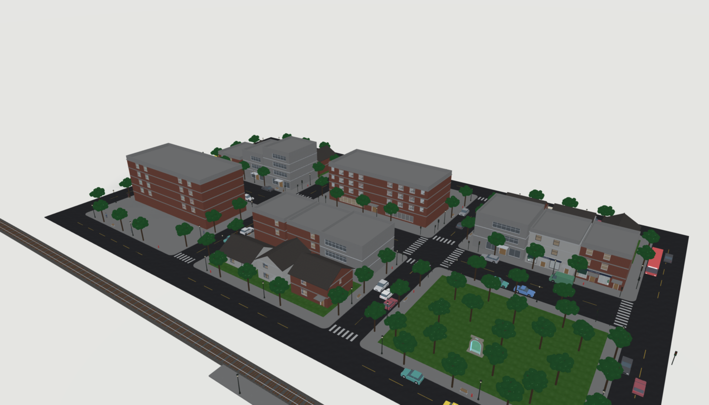
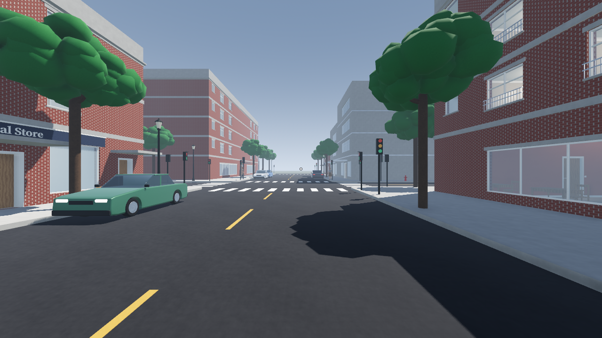
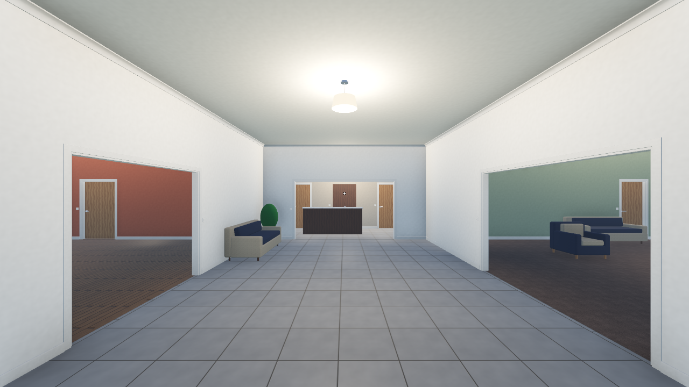
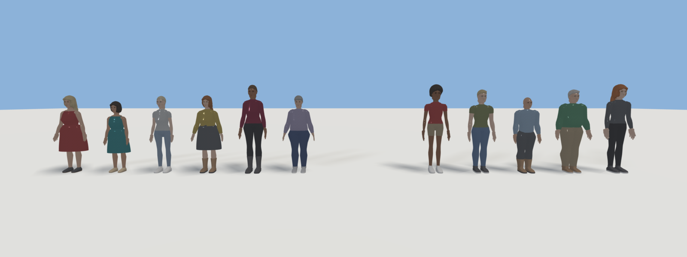
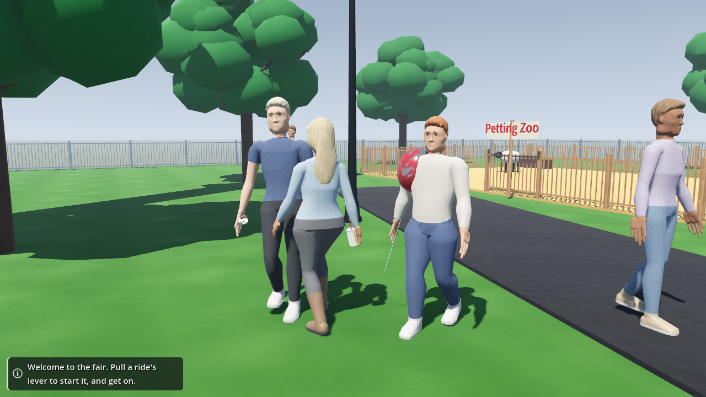

# Geogen

Procedural 3D geometry for game worlds. You describe objects and scenes in YAML and geogen builds watertight, UV-mapped meshes with procedural PBR textures, then renders them, exports them to glTF, or runs them in a Godot 4 runtime you can walk around in.

The goal is nested, generated worlds: cities of neighbourhoods of streets, houses and furnished rooms, with people, traffic and trains going about their day. A town district of that already works.



| Walking the streamed town in Godot | A furnished hotel lobby |
|---|---|
|  |  |

| People, drawn from seeded archetypes | Fairgoers who buy, eat and stay together |
|---|---|
|  |  |

More in [the gallery](docs/gallery.md).

## Try it

- **[Play in the browser](https://falldaysoft.github.io/geogen/play/)**: the Godot runtime built for the web (a desktop browser with WebGL 2, about 110 MB).
- **[Browse the catalogue](https://falldaysoft.github.io/geogen/)**: every primitive, asset and scene, with thumbnails and parameters.
- **Example games**, each built as declarative content in [`examples/`](examples/):
  [Sandwich](https://falldaysoft.github.io/geogen/play/sandwich/),
  [Test chamber](https://falldaysoft.github.io/geogen/play/test_chamber/),
  [Marble run](https://falldaysoft.github.io/geogen/play/marble_run/),
  [Tower defense](https://falldaysoft.github.io/geogen/play/tower_defense/),
  [Survival](https://falldaysoft.github.io/geogen/play/survival/) and
  [Amusement park](https://falldaysoft.github.io/geogen/play/amusement_park/).

## Quick start

Requires Python 3.10+, and [Godot 4.7](https://godotengine.org/download) for the runtime.

```bash
python -m venv .venv && source .venv/bin/activate
pip install -e ".[dev]"

python -m geogen.main -s dining_set                      # interactive viewer
python -m geogen.main -s cottage -r out.png --views      # render a contact sheet
python -m geogen.main -s cottage -e out/cottage.glb      # export glTF
python -m geogen.main -s cottage --export-godot          # then walk it in first person:
godot --path runtime/godot -- --scene cottage
```

## Documentation

- [Guide](docs/guide.md): running, rendering and exporting scenes, the Godot runtime, and writing assets and scenes.
- [Features](docs/features.md): everything geogen does, by area.
- [Gallery](docs/gallery.md): towns, buildings, furniture, people, vehicles and the runtime, with how each is made.
- [Catalogue](docs/catalogue/README.md): the vocabulary of primitives, assets and scenes (also `--describe`).
- [Godot runtime](runtime/godot/README.md): its options, controls, control API and file formats.
- [Developer notes](docs/dev/README.md): how each part works, the package layout and the tests.

## License

MIT
