# Geogen catalogue

Everything a scene can be built from. Generated by `docs/make_catalogue.sh` (`python -m geogen.main --describe --markdown docs/catalogue`); don't edit by hand. The same data prints as text or JSON with `python -m geogen.main --describe [NAME] [--json]`.

- [Primitives](primitives.md): the shapes asset parts are made of, and the keys every part takes
- [Vocabulary](vocabulary.md): asset, scene, slot and placement keys, data kinds, room types, materials
- [Scenes](scenes.md): the composed scenes (`-s NAME`)

```yaml
name: garage_scene
size: [14, 5, 14]
slots:
  drive: {position: [4, 0, 4], facing: south}
place:
  house: {asset: house_peaked.yaml}
  door:  {asset: door.yaml, on: house.front_wall, at: {u: 0.5, v: {abs: 0}}, params: {width: 1.1}, state: open}
  car:   {asset: vehicles/car.yaml, slot: drive, params: {preset: estate, paint: car_red}}
```

## Furniture

<table>
<tr>
<td align="center"><a href="assets/armchair.md">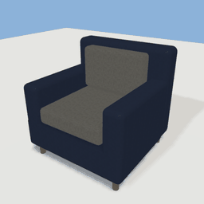<br>armchair</a></td>
<td align="center"><a href="assets/back_bar.md">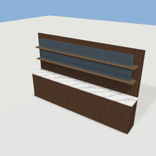<br>back_bar</a></td>
<td align="center"><a href="assets/bar_counter.md"><br>bar_counter</a></td>
<td align="center"><a href="assets/bar_stool.md">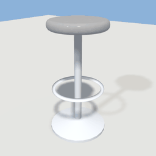<br>bar_stool</a></td>
<td align="center"><a href="assets/bed.md">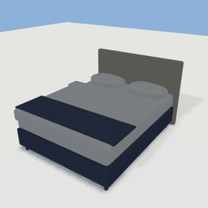<br>bed</a></td>
</tr>
<tr>
<td align="center"><a href="assets/bookshelf.md">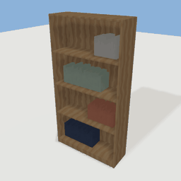<br>bookshelf</a></td>
<td align="center"><a href="assets/booth.md">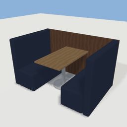<br>booth</a></td>
<td align="center"><a href="assets/chair.md">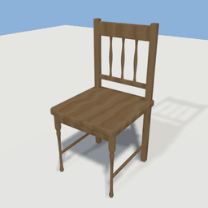<br>chair</a></td>
<td align="center"><a href="assets/coffee_table.md">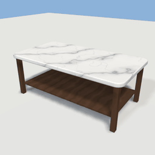<br>coffee_table</a></td>
<td align="center"><a href="assets/curtains.md">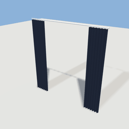<br>curtains</a></td>
</tr>
<tr>
<td align="center"><a href="assets/desk.md">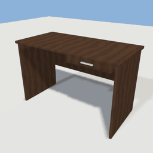<br>desk</a></td>
<td align="center"><a href="assets/desk_chair.md">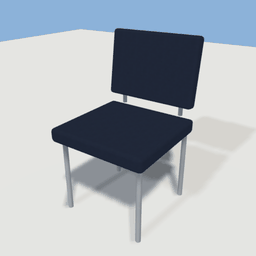<br>desk_chair</a></td>
<td align="center"><a href="assets/floor_lamp.md">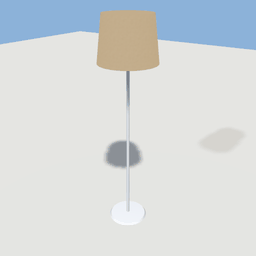<br>floor_lamp</a></td>
<td align="center"><a href="assets/host_stand.md">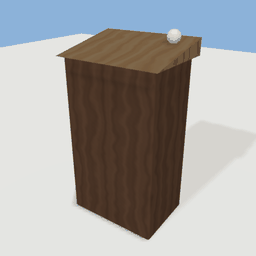<br>host_stand</a></td>
<td align="center"><a href="assets/luggage_rack.md">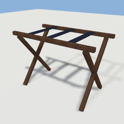<br>luggage_rack</a></td>
</tr>
<tr>
<td align="center"><a href="assets/nightstand.md">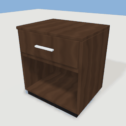<br>nightstand</a></td>
<td align="center"><a href="assets/reception_desk.md">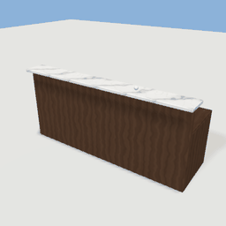<br>reception_desk</a></td>
<td align="center"><a href="assets/rug.md">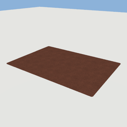<br>rug</a></td>
<td align="center"><a href="assets/sofa.md">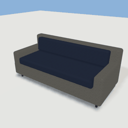<br>sofa</a></td>
<td align="center"><a href="assets/table.md">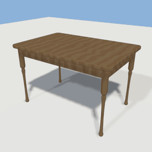<br>table</a></td>
</tr>
<tr>
<td align="center"><a href="assets/table_lamp.md">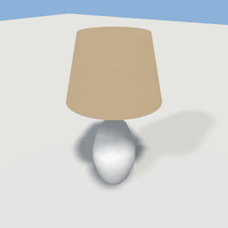<br>table_lamp</a></td>
<td align="center"><a href="assets/table_setting.md">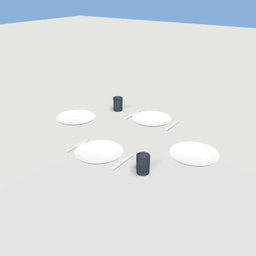<br>table_setting</a></td>
<td align="center"><a href="assets/tv.md">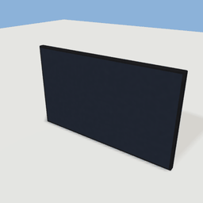<br>tv</a></td>
<td align="center"><a href="assets/tv_console.md">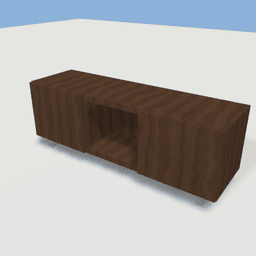<br>tv_console</a></td>
<td align="center"><a href="assets/wall_mirror.md">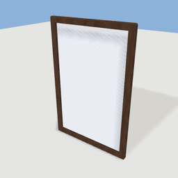<br>wall_mirror</a></td>
</tr>
<tr>
<td align="center"><a href="assets/wardrobe.md">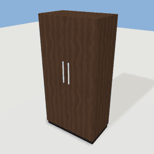<br>wardrobe</a></td>
</tr>
</table>

| Asset | What it is | Params |
| --- | --- | --- |
| [armchair](assets/armchair.md) | Upholstered armchair: box base on short wooden legs, seat and back cushions between padded arms. | `width`, `depth`, `height`, `leg`, `base`, `arm_width`, `arm_top`, `back` |
| [back_bar](assets/back_bar.md) | A back bar: a low cabinet with a marble top against the wall, and a panel above it carrying two shelves of bottles. | `width` |
| [bar_counter](assets/bar_counter.md) | A bar counter: a panelled front with a marble top, beer taps and a brass foot rail. | `width` |
| [bar_stool](assets/bar_stool.md) | A bar stool: a turned chrome base and post, a footring, and a padded round seat 76 cm up. |  |
| [bed](assets/bed.md) | Hotel double bed: upholstered headboard, base on short legs, mattress, duvet folded back at the head, and two pillows. | `width`, `length`, `headboard`, `leg`, `base`, `mattress`, `duvet_lift`, `hb_depth` |
| [bookshelf](assets/bookshelf.md) | Open bookshelf: wooden carcass with back panel, four shelves and rows of books. | `width`, `height`, `depth`, `board`, `plinth` |
| [booth](assets/booth.md) | A restaurant booth: a table between two high-backed upholstered benches. |  |
| [chair](assets/chair.md) | Dining chair: filleted seat, turned front legs, back posts with rails and spindles, and side stretchers. | `width`, `height`, `depth`, `seat_height`, `seat_thickness`, `leg_width`, `leg_inset`, `at_table` |
| [coffee_table](assets/coffee_table.md) | Low coffee table: rounded top on four square legs with a lower shelf. | `width`, `depth`, `height` |
| [curtains](assets/curtains.md) | Pair of pleated curtains on a chrome rod, drawn open to the sides. | `width`, `height`, `panel` |
| [desk](assets/desk.md) | Writing desk: top on two panel ends with a modesty panel and a shallow drawer. | `width`, `height`, `depth`, `board` |
| [desk_chair](assets/desk_chair.md) | Upholstered desk chair on four slim metal legs. | `width`, `depth`, `height`, `seat` |
| [floor_lamp](assets/floor_lamp.md) | Floor lamp: weighted round base, slim pole, drum shade. | `height`, `shade` |
| [host_stand](assets/host_stand.md) | A host stand by a restaurant's door: a slim podium with a sloped top. |  |
| [luggage_rack](assets/luggage_rack.md) | Folding luggage rack: two X-braced wooden frames with webbing straps. | `width`, `depth`, `height` |
| [nightstand](assets/nightstand.md) | Bedside table: carcass with an open shelf, one drawer that slides out (interaction 'drawer'), on a plinth. | `width`, `height`, `depth`, `board`, `drawer` |
| [reception_desk](assets/reception_desk.md) | Reception counter: a raised customer-side transaction ledge over a lower work desk, with a marble top and a modesty panel. | `width`, `depth` |
| [rug](assets/rug.md) | Low-pile area rug with a bound edge. | `width`, `depth` |
| [sofa](assets/sofa.md) | Three-seat sofa: upholstered base and arms, seat and back cushions on low wooden legs. | `width`, `depth`, `height`, `seats` |
| [table](assets/table.md) | Dining table: rounded tabletop, apron frame and turned legs. | `width`, `height`, `depth`, `top_thickness`, `apron_height`, `leg_width`, `leg_inset` |
| [table_lamp](assets/table_lamp.md) | Bedside table lamp: turned ceramic base and a tapered linen shade. | `height`, `shade` |
| [table_setting](assets/table_setting.md) | Places laid on a four-seat table (table.yaml, 1.2 x 0.8 m): a plate at each seat, glasses and cutlery at the long sides. |  |
| [tv](assets/tv.md) | Wall-mounted flat TV. | `width`, `height`, `depth` |
| [tv_console](assets/tv_console.md) | Low media console with two push doors and an open shelf. | `width`, `height`, `depth` |
| [wall_mirror](assets/wall_mirror.md) | Framed wall mirror. | `width`, `height`, `frame` |
| [wardrobe](assets/wardrobe.md) | Two-door wardrobe on a plinth with bar handles; the doors swing out (interaction 'doors'). | `width`, `height`, `depth`, `board`, `plinth`, `door_t` |

## Bathroom

<table>
<tr>
<td align="center"><a href="assets/bathtub.md">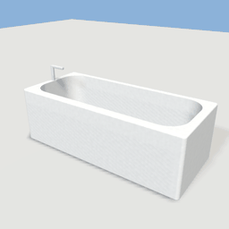<br>bathtub</a></td>
<td align="center"><a href="assets/hand_dryer.md">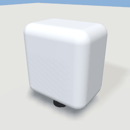<br>hand_dryer</a></td>
<td align="center"><a href="assets/shower.md">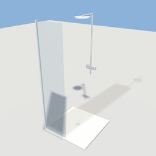<br>shower</a></td>
<td align="center"><a href="assets/toilet.md">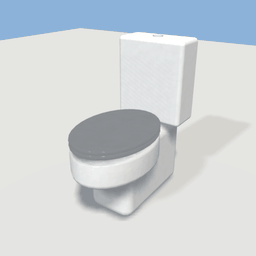<br>toilet</a></td>
<td align="center"><a href="assets/toilet_stall.md">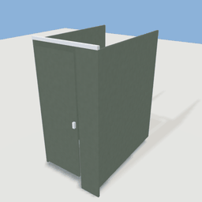<br>toilet_stall</a></td>
</tr>
<tr>
<td align="center"><a href="assets/towel_rail.md">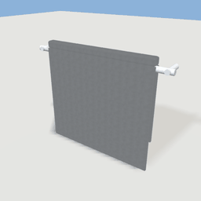<br>towel_rail</a></td>
<td align="center"><a href="assets/vanity.md">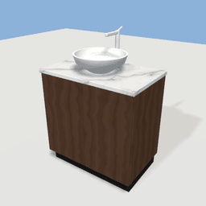<br>vanity</a></td>
</tr>
</table>

| Asset | What it is | Params |
| --- | --- | --- |
| [bathtub](assets/bathtub.md) | Built-in bathtub: ceramic tub with a rounded, sloped-in cavity and a chrome filler at the tap end (-X). | `length`, `width`, `height`, `rim` |
| [hand_dryer](assets/hand_dryer.md) | A wall-mounted hand dryer (brushed steel). |  |
| [shower](assets/shower.md) | Shower: low ceramic tray, fixed glass screen on part of the front, chrome riser rail with a rain head and mixer on the back wall. | `width`, `depth`, `height` |
| [toilet](assets/toilet.md) | Close-coupled toilet: pedestal, oval bowl (hollow), seat, lid that lifts (interaction 'lid') and cistern with a flush button. |  |
| [toilet_stall](assets/toilet_stall.md) | A toilet cubicle: painted side partitions raised off the floor, a front pilaster and a door that swings out on its left side (press E). | `width`, `depth` |
| [towel_rail](assets/towel_rail.md) | Wall-mounted chrome towel rail with a folded towel over the bar. | `width` |
| [vanity](assets/vanity.md) | Bathroom vanity: two-door cabinet, marble top, vessel basin and a chrome mixer tap. | `width`, `depth`, `top` |

## Decor and lighting

<table>
<tr>
<td align="center"><a href="assets/butter_knife.md">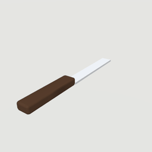<br>butter_knife</a></td>
<td align="center"><a href="assets/ceiling_light.md">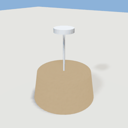<br>ceiling_light</a></td>
<td align="center"><a href="assets/floor_pad.md"><br>floor_pad</a></td>
<td align="center"><a href="assets/menu_board.md">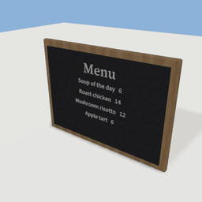<br>menu_board</a></td>
<td align="center"><a href="assets/planter.md">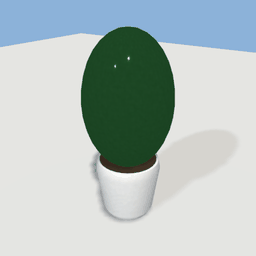<br>planter</a></td>
</tr>
<tr>
<td align="center"><a href="assets/plate.md">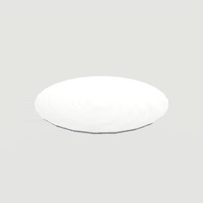<br>plate</a></td>
<td align="center"><a href="assets/switch_board.md">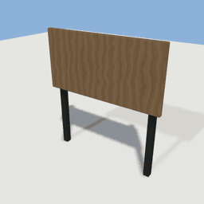<br>switch_board</a></td>
<td align="center"><a href="assets/wall_art.md">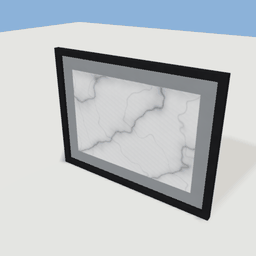<br>wall_art</a></td>
</tr>
</table>

| Asset | What it is | Params |
| --- | --- | --- |
| [butter_knife](assets/butter_knife.md) | A butter knife lying flat, handle toward +Z. |  |
| [ceiling_light](assets/ceiling_light.md) | Ceiling pendant: a canopy, a thin stem and a tapered shade. | `drop`, `shade` |
| [floor_pad](assets/floor_pad.md) | A painted square on the ground to stand on. | `width`, `depth` |
| [menu_board](assets/menu_board.md) | A wall-mounted chalkboard menu in a wooden frame. | `title` |
| [planter](assets/planter.md) | Potted plant: turned ceramic pot with a leafy bush. | `height` |
| [plate](assets/plate.md) | A white dinner plate. |  |
| [switch_board](assets/switch_board.md) | A board on two posts for wall switches. | `width`, `height`, `panel`, `depth` |
| [wall_art](assets/wall_art.md) | Framed print for a wall. | `width`, `height`, `frame`, `mat` |

## Shops and restaurants

<table>
<tr>
<td align="center"><a href="assets/cafe_counter.md">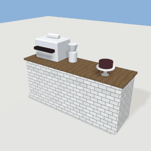<br>cafe_counter</a></td>
<td align="center"><a href="assets/clothes_rail.md">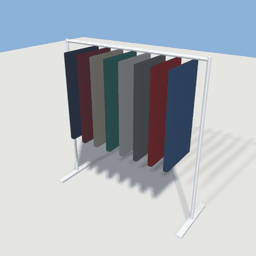<br>clothes_rail</a></td>
<td align="center"><a href="assets/display_case.md">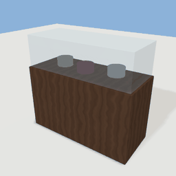<br>display_case</a></td>
<td align="center"><a href="assets/fridge.md">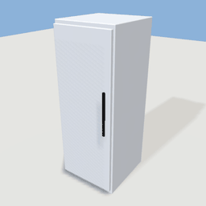<br>fridge</a></td>
<td align="center"><a href="assets/gondola.md"><br>gondola</a></td>
</tr>
<tr>
<td align="center"><a href="assets/kitchen_counter.md">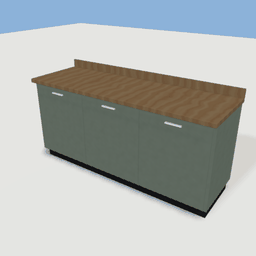<br>kitchen_counter</a></td>
<td align="center"><a href="assets/kitchen_range.md"><br>kitchen_range</a></td>
<td align="center"><a href="assets/pass.md">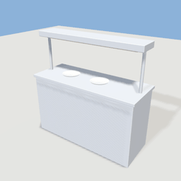<br>pass</a></td>
<td align="center"><a href="assets/prep_counter.md">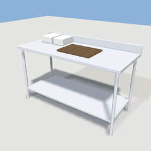<br>prep_counter</a></td>
<td align="center"><a href="assets/till_counter.md">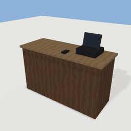<br>till_counter</a></td>
</tr>
<tr>
<td align="center"><a href="assets/wall_shelving.md">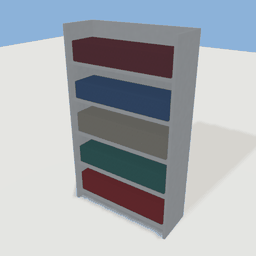<br>wall_shelving</a></td>
</tr>
</table>

| Asset | What it is | Params |
| --- | --- | --- |
| [cafe_counter](assets/cafe_counter.md) | A cafe counter: a tiled counter with an espresso machine, a grinder, a cake stand and cups. | `width` |
| [clothes_rail](assets/clothes_rail.md) | A clothes rail: a chrome rail on two uprights with a row of garments on hangers (thin boxes in mixed colours). | `length` |
| [display_case](assets/display_case.md) | A glass-topped display case (cakes in a cafe, books or jewellery in a shop): a cabinet with a glass box on top holding a few items. | `width` |
| [fridge](assets/fridge.md) | A tall stainless commercial fridge with one full-height door (press E to open it; it swings on its left side). |  |
| [gondola](assets/gondola.md) | A gondola: a free-standing double-sided shop shelf with stock on both faces and an end cap. | `length` |
| [kitchen_counter](assets/kitchen_counter.md) | A fitted kitchen counter: base units under a worktop. | `width` |
| [kitchen_range](assets/kitchen_range.md) | A commercial range: a stainless six-burner cooker with oven doors, a splashback and an extractor hood above. | `width` |
| [pass](assets/pass.md) | The pass: a stainless counter where plates wait to go out, under a gantry of heat lamps. | `width` |
| [prep_counter](assets/prep_counter.md) | A stainless prep table with an undershelf, a chopping board and a few tubs. | `width` |
| [till_counter](assets/till_counter.md) | A shop counter with a till: a wooden counter, a till screen and card reader on top. | `width` |
| [wall_shelving](assets/wall_shelving.md) | Shop wall shelving: a tall steel unit with five shelves of stock (rows of boxes and tins in mixed colours). | `width` |

## Buildings and openings

<table>
<tr>
<td align="center"><a href="assets/awning.md">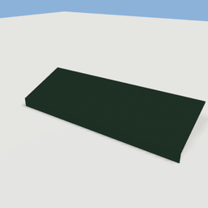<br>awning</a></td>
<td align="center"><a href="assets/door.md">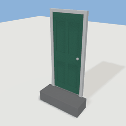<br>door</a></td>
<td align="center"><a href="assets/fascia_sign.md"><br>fascia_sign</a></td>
<td align="center"><a href="assets/handrail.md"><br>handrail</a></td>
<td align="center"><a href="assets/hotel.md"><br>hotel</a></td>
</tr>
<tr>
<td align="center"><a href="assets/hotel_floor.md"><br>hotel_floor</a></td>
<td align="center"><a href="assets/hotel_lobby.md"><br>hotel_lobby</a></td>
<td align="center"><a href="assets/hotel_suite.md"><br>hotel_suite</a></td>
<td align="center"><a href="assets/house_peaked.md"><br>house_peaked</a></td>
<td align="center"><a href="assets/house_simple.md"><br>house_simple</a></td>
</tr>
<tr>
<td align="center"><a href="assets/kitchen.md"><br>kitchen</a></td>
<td align="center"><a href="assets/lighthouse.md"><br>lighthouse</a></td>
<td align="center"><a href="assets/restaurant_building.md"><br>restaurant_building</a></td>
<td align="center"><a href="assets/room.md"><br>room</a></td>
<td align="center"><a href="assets/shop.md"><br>shop</a></td>
</tr>
<tr>
<td align="center"><a href="assets/staircase.md"><br>staircase</a></td>
<td align="center"><a href="assets/window.md"><br>window</a></td>
</tr>
</table>

| Asset | What it is | Params |
| --- | --- | --- |
| [awning](assets/awning.md) | A shopfront awning: a fabric canopy sloping out from the wall over the windows, with a scalloped valance. | `width`, `reach`, `drop`, `color` |
| [door](assets/door.md) | Four-panel front door with frame, knob and step. | `width`, `height`, `frame`, `recess`, `step_height`, `leaf_gap`, `open_angle` |
| [fascia_sign](assets/fascia_sign.md) | A shop or restaurant fascia: a painted board with raised lettering and a slim cap, for fixing across a front wall above the door and windows. | `label`, `width`, `height`, `letter`, `font` |
| [handrail](assets/handrail.md) | Stair/landing handrail: turned posts and a round rail swept along a path that bends down into the floor at both ends. | `length`, `height` |
| [hotel](assets/hotel.md) | A generated hotel: lobby level plus three guest floors, stair cores at both ends, flat roof with a parapet. |  |
| [hotel_floor](assets/hotel_floor.md) | A generated hotel guest floor: double-loaded corridor with fire stairs at the ends, a lift lobby mid-floor and ensuite guest rooms on both sides. |  |
| [hotel_lobby](assets/hotel_lobby.md) | Generated hotel ground floor: street entrance, lobby, reception, lounge, restaurant, restrooms and back-of-house. |  |
| [hotel_suite](assets/hotel_suite.md) | Hotel suite floor plan: bedroom, ensuite bathroom and an entry corridor. |  |
| [house_peaked](assets/house_peaked.md) | Brick cottage shell with a pitched (gable) roof. | `width`, `depth`, `wall_height`, `roof_height`, `foundation`, `wall_thickness`, `overhang`, `floor_thickness`, `lining_thickness`, `ceiling_thickness` |
| [house_simple](assets/house_simple.md) | Simple house — parametric rectangular house with flat roof. | `width`, `depth`, `height` |
| [kitchen](assets/kitchen.md) | A small domestic kitchen: one tiled room. |  |
| [lighthouse](assets/lighthouse.md) | A lighthouse you can climb: a tapering white tower with red bands, a doorway on +Z into the ground floor, a spiral stair round a central column up to the gallery deck, a glazed lantern room (with a doorway out onto the gallery, which has a railing), a red cap, and the lamp on top of the stair column. | `height`, `base_r`, `top_r`, `wall` |
| [restaurant_building](assets/restaurant_building.md) | A corner restaurant: a dining room and a bar at the front (street door on the south side), the kitchen and two restrooms behind, and a back door out of the kitchen. |  |
| [room](assets/room.md) | Single room with a door and windows, built as a one-room floor plan (clean wall corners, finishes, a hinged door). |  |
| [shop](assets/shop.md) | Corner shop: a double-height storefront on the ground floor with a stock room behind, and a flat above. |  |
| [staircase](assets/staircase.md) | Parametric staircase: straight, L-shaped (quarter landing) or spiral, with handrails. | `rise`, `width` |
| [window](assets/window.md) | Casement window with frame, glazing bars, sill and lintel. | `width`, `height`, `frame`, `recess` |

## Vehicles

<table>
<tr>
<td align="center"><a href="assets/bus.md"><br>bus</a></td>
<td align="center"><a href="assets/car.md"><br>car</a></td>
<td align="center"><a href="assets/carriage.md"><br>carriage</a></td>
<td align="center"><a href="assets/loco.md"><br>loco</a></td>
<td align="center"><a href="assets/van.md"><br>van</a></td>
</tr>
</table>

| Asset | What it is | Params |
| --- | --- | --- |
| [bus](assets/bus.md) | A single-deck city bus: flat front, a continuous window band with painted pillars, doors on the right (kerb side for right-hand traffic; -X). | `length`, `width`, `height`, `wheelbase`, `wheel_r`, `tyre_w`, `belt`, `window_top`, `pane`, `paint` |
| [car](assets/car.md) | A parametric car: sedan, hatchback, estate or taxi (presets). | `length`, `width`, `wheelbase`, `wheel_r`, `tyre_w`, `belt`, `hood`, `deck`, `roof`, `screen_z`, `roof_f`, `roof_r`, `back_z`, `taxi`, `paint` |
| [carriage](assets/carriage.md) | A passenger carriage: a long body with a rounded roof, a window band, two doors a side and two bogies. | `length`, `width`, `bogie_gap`, `wheel_r`, `gauge`, `floor`, `paint`, `stripe` |
| [loco](assets/loco.md) | A diesel locomotive: cabs with windscreens at both ends, louvred engine sides, head and tail lamps, two bogies. | `length`, `width`, `bogie_gap`, `wheel_r`, `gauge`, `floor`, `paint`, `stripe` |
| [van](assets/van.md) | A panel van: short bonnet, glazed cab, windowless cargo box. | `length`, `width`, `height`, `wheelbase`, `wheel_r`, `tyre_w`, `belt`, `hood`, `cab_len`, `paint` |

## Nature

<table>
<tr>
<td align="center"><a href="assets/bush.md"><br>bush</a></td>
<td align="center"><a href="assets/crop_patch.md"><br>crop_patch</a></td>
<td align="center"><a href="assets/island_grounds.md"><br>island_grounds</a></td>
<td align="center"><a href="assets/island_terrain.md"><br>island_terrain</a></td>
<td align="center"><a href="assets/maple_tree.md"><br>maple_tree</a></td>
</tr>
<tr>
<td align="center"><a href="assets/palm_tree.md"><br>palm_tree</a></td>
<td align="center"><a href="assets/pine_tree.md"><br>pine_tree</a></td>
<td align="center"><a href="assets/pond.md"><br>pond</a></td>
<td align="center"><a href="assets/rock_large.md"><br>rock_large</a></td>
<td align="center"><a href="assets/rock_medium.md"><br>rock_medium</a></td>
</tr>
<tr>
<td align="center"><a href="assets/rock_small.md"><br>rock_small</a></td>
</tr>
</table>

| Asset | What it is | Params |
| --- | --- | --- |
| [bush](assets/bush.md) | Bush/shrub - cluster of overlapping spheres, noise-displaced into lumpy foliage. | `width`, `height`, `depth` |
| [crop_patch](assets/crop_patch.md) | A bed of tilled soil with a crop growing in it: the crop generator's review piece, and the look of a farm plot (crop `kind` at `growth` 0-1). | `kind`, `growth`, `seed`, `height` |
| [island_grounds](assets/island_grounds.md) | The island showcase's ground (scenes/island.yaml): terrain rising from sandy beaches to a wooded hill, levelled pads for the jetty, the hub portal, two cottages and the lighthouse, gravel paths between them, the sea all round, and an invisible wall where the water gets half a metre deep (with a gap where the jetty runs out over it). | `sea_level` |
| [island_terrain](assets/island_terrain.md) | An island in the sea: noise hills inside a wobbly coastline (sand at the shore, rock on steep slopes, grass elsewhere), a sea sheet reaching well past the terrain, and an invisible wall where the water gets half a metre deep. | `extent`, `peak`, `sea_level`, `sea`, `seed` |
| [maple_tree](assets/maple_tree.md) | Maple tree - a space-colonisation branch skeleton with leaf clusters (generators/nature.py). | `scale`, `seed`, `height`, `trunk` |
| [palm_tree](assets/palm_tree.md) | Palm tree - a curved, leaning trunk with a crown of arched fronds and coconuts (generators/nature.py, style: palm). | `scale`, `seed`, `height`, `fronds` |
| [pine_tree](assets/pine_tree.md) | Pine tree - a conifer grown by space colonisation (generators/nature.py). | `scale`, `seed` |
| [pond](assets/pond.md) | An oval ornamental pond: a knee-high stone rim, a dark bed, still water, and (fountain: 1) a two-tier stone fountain in the middle with a water jet. | `rx`, `rz`, `rim`, `rim_height`, `fountain` |
| [rock_large](assets/rock_large.md) | large rock - a random convex cage, subdivided with creases and noise-displaced (primitive: rock, generators/nature.py). | `width`, `height`, `depth`, `seed` |
| [rock_medium](assets/rock_medium.md) | medium rock - a random convex cage, subdivided with creases and noise-displaced (primitive: rock, generators/nature.py). | `width`, `height`, `depth`, `seed` |
| [rock_small](assets/rock_small.md) | small rock - a random convex cage, subdivided with creases and noise-displaced (primitive: rock, generators/nature.py). | `width`, `height`, `depth`, `seed` |

## Street and park

<table>
<tr>
<td align="center"><a href="assets/bandstand.md"><br>bandstand</a></td>
<td align="center"><a href="assets/bench.md"><br>bench</a></td>
<td align="center"><a href="assets/bus_shelter.md"><br>bus_shelter</a></td>
<td align="center"><a href="assets/crossing_barrier.md"><br>crossing_barrier</a></td>
<td align="center"><a href="assets/fire_hydrant.md"><br>fire_hydrant</a></td>
</tr>
<tr>
<td align="center"><a href="assets/ground.md"><br>ground</a></td>
<td align="center"><a href="assets/info_plinth.md"><br>info_plinth</a></td>
<td align="center"><a href="assets/jetty.md"><br>jetty</a></td>
<td align="center"><a href="assets/lettering.md"><br>lettering</a></td>
<td align="center"><a href="assets/mailbox.md"><br>mailbox</a></td>
</tr>
<tr>
<td align="center"><a href="assets/park_gate.md"><br>park_gate</a></td>
<td align="center"><a href="assets/park_grounds.md"><br>park_grounds</a></td>
<td align="center"><a href="assets/pedestrian_signal.md"><br>pedestrian_signal</a></td>
<td align="center"><a href="assets/picnic_table.md"><br>picnic_table</a></td>
<td align="center"><a href="assets/playground.md"><br>playground</a></td>
</tr>
<tr>
<td align="center"><a href="assets/plaza.md"><br>plaza</a></td>
<td align="center"><a href="assets/portal.md"><br>portal</a></td>
<td align="center"><a href="assets/road.md"><br>road</a></td>
<td align="center"><a href="assets/road_section.md"><br>road_section</a></td>
<td align="center"><a href="assets/rowing_boat.md"><br>rowing_boat</a></td>
</tr>
<tr>
<td align="center"><a href="assets/sidewalk.md"><br>sidewalk</a></td>
<td align="center"><a href="assets/signal_head.md"><br>signal_head</a></td>
<td align="center"><a href="assets/signpost.md"><br>signpost</a></td>
<td align="center"><a href="assets/street_lamp.md"><br>street_lamp</a></td>
<td align="center"><a href="assets/trashcan.md"><br>trashcan</a></td>
</tr>
<tr>
<td align="center"><a href="assets/travel_door.md"><br>travel_door</a></td>
</tr>
</table>

| Asset | What it is | Params |
| --- | --- | --- |
| [bandstand](assets/bandstand.md) | An octagonal bandstand: a stone plinth with steps at the front (+Z), eight white posts, a rail on seven sides (open at the steps), a ring beam and an octagonal roof with a finial. | `radius`, `deck`, `posts` |
| [bench](assets/bench.md) | Park bench with metal frame and wood slats. | `length`, `height`, `depth` |
| [bus_shelter](assets/bus_shelter.md) | A bus shelter: a steel frame with a glass back and ends, a flat roof, a perch bench and a timetable panel with the stop's name. | `label`, `width` |
| [crossing_barrier](assets/crossing_barrier.md) | Level crossing barrier: a post with a red-and-white arm that lowers across a road lane. | `reach` |
| [fire_hydrant](assets/fire_hydrant.md) | Fire hydrant - classic American style. | `width`, `height` |
| [ground](assets/ground.md) | Ground plane - flat grass surface. | `width`, `thickness`, `depth` |
| [info_plinth](assets/info_plinth.md) | A waist-high stone plinth with a lettered front and a glowing cap band. | `label`, `width`, `height`, `depth`, `letter` |
| [jetty](assets/jetty.md) | A timber jetty on piles: a plank deck on stringers and cross bearers, piles driven `pile_depth` below the deck that rise above it as the railing posts, a top and a mid rail on both sides, and a landing at the far end where the left rail stops for boats (a ladder down, a mooring bollard). | `length`, `width`, `pile_depth`, `landing` |
| [lettering](assets/lettering.md) | Review asset for primitive: text (extruded lettering, sans and serif, letters with counters). | `label` |
| [mailbox](assets/mailbox.md) | US rural-style mailbox on a post. | `width`, `height`, `depth` |
| [park_gate](assets/park_gate.md) | A park gateway: two stone piers with lanterns, a wrought-iron arch between them and a lettered sign hung from it. | `label`, `width`, `pier`, `height` |
| [park_grounds](assets/park_grounds.md) | The park's grounds: a lawn, a network of gravel paths (tagged park.path, which park visitors walk) and railings round the edge with a gap for the gate at the south (-Z) end. |  |
| [pedestrian_signal](assets/pedestrian_signal.md) | Pedestrian signal: a post with a two-lamp head facing +Z (toward the person about to cross to it). |  |
| [picnic_table](assets/picnic_table.md) | A timber picnic table with bench seats on both long sides, carried on two crossbars. | `length` |
| [playground](assets/playground.md) | A small playground on a poured-rubber pad: an A-frame swing set, a slide with a deck and ladder, a climbing frame and a see-saw. |  |
| [plaza](assets/plaza.md) | A round paved plaza: grey tiles inside a pale stone border (by default), 10 cm high. | `radius`, `border`, `thickness`, `paving_material`, `border_material` |
| [portal](assets/portal.md) | A walk-through portal: a stone arch on a plinth with a glowing rim, a translucent membrane and the destination lettered above the opening. | `label`, `width`, `height`, `band`, `depth`, `plinth`, `letter`, `plaque` |
| [road](assets/road.md) | Road surface - just the asphalt. | `width`, `thickness`, `length` |
| [road_section](assets/road_section.md) | Road section with sidewalks on both sides. | `width`, `thickness`, `length` |
| [rowing_boat](assets/rowing_boat.md) | A small clinker-style rowing boat: a painted hull (a half ellipsoid, hollowed), a wooden rubbing strake, two thwarts and a stern bench, and a pair of oars shipped along the seats. | `length`, `beam`, `draft`, `freeboard`, `hull_color` |
| [sidewalk](assets/sidewalk.md) | Sidewalk - concrete walkway. | `width`, `thickness`, `length` |
| [signal_head](assets/signal_head.md) | Traffic signal: a post with a three-lamp head facing +Z (toward the traffic it controls). |  |
| [signpost](assets/signpost.md) | A fingerpost: a post with up to four arrow boards, each lettered on both faces and pointing along a compass bearing (0 = north / +Z, 90 = east / +X). | `arm1`, `arm2`, `arm3`, `arm4`, `dir1`, `dir2`, `dir3`, `dir4`, `post_height`, `arm_length`, `letter` |
| [street_lamp](assets/street_lamp.md) | Street lamp: a tapered cast-iron post with a glass lantern. | `scale` |
| [trashcan](assets/trashcan.md) | City street trash receptacle. | `width`, `height`, `depth` |
| [travel_door](assets/travel_door.md) | A freestanding door in a frame that leads somewhere else: press E on the leaf to travel (geogen/travel.py). | `label`, `width`, `height`, `transom`, `frame`, `depth`, `plinth`, `letter`, `board` |

## Characters

<table>
<tr>
<td align="center"><a href="assets/capsule.md"><br>capsule</a></td>
<td align="center"><a href="assets/humanoid.md"><br>humanoid</a></td>
</tr>
</table>

| Asset | What it is | Params |
| --- | --- | --- |
| [capsule](assets/capsule.md) | Placeholder character body: a capsule with a visor showing which way it faces (+Z). | `height`, `radius` |
| [humanoid](assets/humanoid.md) | Parametric humanoid body: the humanoid skeleton (assets/skeletons/humanoid.yaml) skinned by ring-lofted chains (generators/ringloft.py). | `height`, `build`, `shoulder_width`, `hip_width`, `leg_ratio`, `hips`, `waist`, `bust`, `glutes`, `limb`, `limb_scale`, `belly`, `head_size`, `jaw_width`, `neck_length`, `hand_size`, `foot_length`, `skin_tone`, `hair_style`, `hair_color`, `eye_color`, `outfit`, `top_color`, `bottom_color`, `shoe_color`, `lashes`, `lip_strength`, `blush`, `freckles`, `brow_thickness`, `brow_arch`, `seat_height`, `table_height`, `sill_height` |

## Other

<table>
<tr>
<td align="center"><a href="assets/carrot_bunch.md"><br>carrot_bunch</a></td>
<td align="center"><a href="assets/conveyor.md"><br>conveyor</a></td>
<td align="center"><a href="assets/crisps_bag.md"><br>crisps_bag</a></td>
<td align="center"><a href="assets/farm_field.md"><br>farm_field</a></td>
<td align="center"><a href="assets/farm_plot.md"><br>farm_plot</a></td>
</tr>
<tr>
<td align="center"><a href="assets/farm_shed.md"><br>farm_shed</a></td>
<td align="center"><a href="assets/jar.md"><br>jar</a></td>
<td align="center"><a href="assets/lever.md"><br>lever</a></td>
<td align="center"><a href="assets/light_switch.md"><br>light_switch</a></td>
<td align="center"><a href="assets/loaf.md"><br>loaf</a></td>
</tr>
<tr>
<td align="center"><a href="assets/parcel.md"><br>parcel</a></td>
<td align="center"><a href="assets/produce_counter.md"><br>produce_counter</a></td>
<td align="center"><a href="assets/pumpkin.md"><br>pumpkin</a></td>
<td align="center"><a href="assets/room_key.md"><br>room_key</a></td>
<td align="center"><a href="assets/rover.md"><br>rover</a></td>
</tr>
<tr>
<td align="center"><a href="assets/seed_packet.md"><br>seed_packet</a></td>
<td align="center"><a href="assets/snack_bar.md"><br>snack_bar</a></td>
<td align="center"><a href="assets/soda_can.md"><br>soda_can</a></td>
<td align="center"><a href="assets/spawner.md"><br>spawner</a></td>
<td align="center"><a href="assets/turret.md"><br>turret</a></td>
</tr>
<tr>
<td align="center"><a href="assets/vend_chute.md"><br>vend_chute</a></td>
<td align="center"><a href="assets/vending_cabinet.md"><br>vending_cabinet</a></td>
<td align="center"><a href="assets/wheat_sheaf.md"><br>wheat_sheaf</a></td>
</tr>
</table>

| Asset | What it is | Params |
| --- | --- | --- |
| [carrot_bunch](assets/carrot_bunch.md) | A bunch of carrots: three orange roots side by side with their green tops. |  |
| [conveyor](assets/conveyor.md) | A belt conveyor: a black rubber belt between steel rails on four legs. | `length`, `height`, `width`, `speed`, `end` |
| [crisps_bag](assets/crisps_bag.md) | A bag of crisps. | `colour` |
| [farm_field](assets/farm_field.md) | A farm's field: a fenced rectangle of grass for plots, with a gate gap in the east side and a gravel track from it. | `width`, `depth` |
| [farm_plot](assets/farm_plot.md) | A tilled plot to grow a crop in: a raised bed of soil. | `stage_hours`, `seed` |
| [farm_shed](assets/farm_shed.md) | A farm's lean-to shed to sleep in: a plank floor, three board walls and a sloping roof, open at the front, with a cot inside. |  |
| [jar](assets/jar.md) | A glass jar of peanut butter or jam. | `spread`, `contents`, `lid_color`, `label_color` |
| [lever](assets/lever.md) | A floor lever: a cast base with a handle that throws forward and back. | `height` |
| [light_switch](assets/light_switch.md) | Wall light switch: a plate with a rocker that tips when switched off. | `light` |
| [loaf](assets/loaf.md) | A loaf of bread with two slices cut at its +Z end. |  |
| [parcel](assets/parcel.md) | A taped cardboard parcel: a belt item for conveyors (items/parcel.yaml). | `width`, `height`, `depth` |
| [produce_counter](assets/produce_counter.md) | A produce counter that buys what a farm grows: a wooden market counter with three crates on it (wheat, carrots, pumpkin) under a WE BUY sign. | `wheat_price`, `carrot_price`, `pumpkin_price` |
| [pumpkin](assets/pumpkin.md) | A pumpkin: a squashed orange ball with a stalk. |  |
| [room_key](assets/room_key.md) | A room key on a red fob, to pick up. |  |
| [rover](assets/rover.md) | A little yellow delivery rover on four wheels with a sensor dome: a walking item for tracks (items/rover.yaml). |  |
| [seed_packet](assets/seed_packet.md) | A packet of seeds. | `colour` |
| [snack_bar](assets/snack_bar.md) | A chocolate bar. | `colour` |
| [soda_can](assets/soda_can.md) | A drink can. | `colour`, `band` |
| [spawner](assets/spawner.md) | A spawner arch: two posts and a lintel with a glowing strip, and a source of spawned items (geogen.flows) between the posts. `item` is the item file it makes, `rate` how many a second, or `waves` a waves file it plays instead; `drop` lifts the spawn point (a belt's height, so it feeds a conveyor's back end). | `item`, `waves`, `rate`, `drop`, `initial`, `max_alive`, `count`, `width`, `height` |
| [turret](assets/turret.md) | A small gun turret: a steel drum base, a post and a turning head with a barrel. | `range`, `rate`, `damage`, `targets`, `enabled` |
| [vend_chute](assets/vend_chute.md) | A vending machine's drop point. | `item` |
| [vending_cabinet](assets/vending_cabinet.md) | A vending machine's cabinet. | `colour`, `title`, `a_label`, `a_price`, `a_stock`, `a_tint`, `b_label`, `b_price`, `b_stock`, `b_tint`, `c_label`, `c_price`, `c_stock`, `c_tint`, `d_label`, `d_price`, `d_stock`, `d_tint` |
| [wheat_sheaf](assets/wheat_sheaf.md) | A sheaf of wheat: a bundle of straw-gold stalks tied round the middle, ears at one end. |  |
