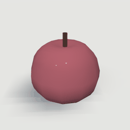
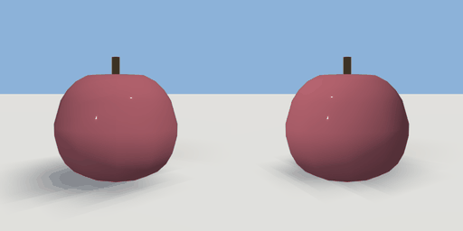

# apple

`asset: apple.yaml` · [source](../../../assets/apple.yaml) · `decor.food` `prop.apple`

 

An apple, taken by its top (motions take, bite).
Origin: the middle of its base.

```yaml
place:
  apple: {asset: apple.yaml, params: {colour: maroon}}
```

## Params

| Param | Default | Choices | Notes |
| --- | --- | --- | --- |
| `colour` | `maroon` | text |  |

## Size

0.08 x 0.074 x 0.08 m (x, y, z); geometry (-0.04, 0.004, -0.04) to (0.04, 0.078, 0.04) from the origin; 336 triangles

## Parts

`fruit` (lathe), `stem` (cylinder)

## Attachments

| Attachment | Position | Facing |
| --- | --- | --- |
| `top` | (0, 0.07, 0) | center |
