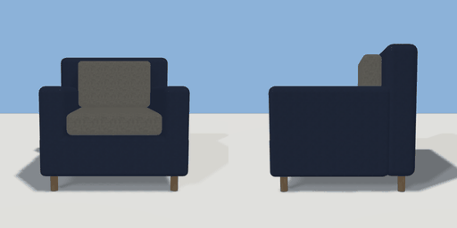

# armchair

`asset: armchair.yaml` · [source](../../../assets/armchair.yaml) · `furniture.armchair`

 

Upholstered armchair: box base on short wooden legs, seat and back
cushions between padded arms. Origin bottom_center, front (seat) faces +Z.

```yaml
place:
  armchair: {asset: armchair.yaml, params: {width: 0.86, depth: 0.84}}
```

## Params

| Param | Default | Choices | Notes |
| --- | --- | --- | --- |
| `width` | `0.86` |  |  |
| `depth` | `0.84` |  |  |
| `height` | `0.86` |  |  |
| `leg` | `0.1` |  | leg height (base sits on the legs) |
| `base` | `0.24` |  | upholstered base height |
| `arm_width` | `0.15` |  |  |
| `arm_top` | `0.62` |  | arm height above the floor |
| `back` | `0.18` |  | backrest thickness |

## Size

0.86 x 0.86 x 0.84 m (x, y, z); geometry (-0.43, 0, -0.42) to (0.43, 0.86, 0.42) from the origin; 1992 triangles

## Parts

`base` (cube), `backrest` (cube), `arm_left` (cube), `arm_right` (cube), `seat_cushion` (cube), `back_cushion` (cube), `leg_fl` (cylinder), `leg_fr` (cylinder), `leg_bl` (cylinder), `leg_br` (cylinder)

## Attachments

| Attachment | Position | Facing |
| --- | --- | --- |
| `sit` | (0, 0, 0.77) | outward |

## Surfaces

| Surface | Size (u x v, m) | Facing |
| --- | --- | --- |
| `seat` | 0.55 x 0.64 | +Y |

## Affordances

sit at (0, 0.47, 0.08) height 0.47 [seat, comfy]

## Clearance

front 0.6
