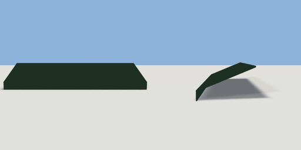

# awning

`asset: awning.yaml` · [source](../../../assets/awning.yaml) · `decor.awning` `decor.wall`

 

A shopfront awning: a fabric canopy sloping out from the wall over the
windows, with a scalloped valance. Wall-mounted: origin on the wall plane
at the canopy's top edge centre, projecting along +Z.

```yaml
place:
  awning: {asset: awning.yaml, params: {color: beige, width: 4}}
```

## Params

| Param | Default | Choices | Notes |
| --- | --- | --- | --- |
| `width` | `4` |  |  |
| `reach` | `1.2` |  |  |
| `drop` | `0.5` |  |  |
| `color` | `british_green` | british_green, car_red, car_navy, maroon, teal_green, beige |  |

## Size

4 x 0.72 x 1.21 m (x, y, z); geometry (-2, -0.72, 0) to (2, 0, 1.21) from the origin; 24 triangles

## Parts

`canopy` (extrude), `valance` (cube)
