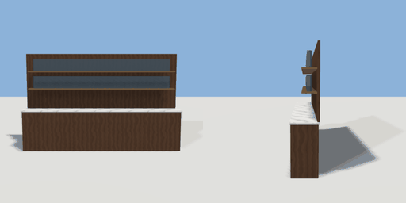

# back_bar

`asset: back_bar.yaml` · [source](../../../assets/back_bar.yaml) · `furniture.back_bar`

 

A back bar: a low cabinet with a marble top against the wall, and a panel
above it carrying two shelves of bottles. The bar counter stands in front
of it (room_types/bar.yaml: front_of back_bar), leaving the staff aisle.
Origin: bottom centre; back at -Z against the wall.

```yaml
place:
  back_bar: {asset: back_bar.yaml, params: {width: 3.6}}
```

## Params

| Param | Default | Choices | Notes |
| --- | --- | --- | --- |
| `width` | `3.6` |  |  |

## Size

3.64 x 2.24 x 0.5 m (x, y, z); geometry (-1.82, 0, -0.23) to (1.82, 2.24, 0.27) from the origin; 1012 triangles

## Parts

`cabinet` (cube), `top` (cube), `board` (cube), `shelf_low` (cube), `shelf_high` (cube), `bottles_low` (extrude), `bottles_high` (extrude)

## Clearance

front 1
