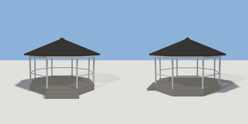

# bandstand

`asset: bandstand.yaml` · [source](../../../assets/bandstand.yaml) · `decor.bandstand`

 

An octagonal bandstand: a stone plinth with steps at the front (+Z), eight
white posts, a rail on seven sides (open at the steps), a ring beam and an
octagonal roof with a finial. People stand inside to look out.
Origin: bottom centre.

```yaml
place:
  bandstand: {asset: bandstand.yaml, params: {radius: 3.2, deck: 0.6}}
```

## Params

| Param | Default | Choices | Notes |
| --- | --- | --- | --- |
| `radius` | `3.2` |  | plinth corner radius |
| `deck` | `0.6` |  | deck height |
| `posts` | `2.6` |  | post height above the deck |

## Size

6.744 x 4.97 x 7.029 m (x, y, z); geometry (-3.372, 0, -3.372) to (3.372, 4.97, 3.657) from the origin; 4616 triangles

## Parts

`plinth` (extrude), `step_1` (cube), `step_2` (cube), `post_0` (cylinder), `post_1` (cylinder), `post_2` (cylinder), `post_3` (cylinder), `post_4` (cylinder), `post_5` (cylinder), `post_6` (cylinder), `post_7` (cylinder), `ring_beam` (sweep), `rail` (sweep), `roof` (lathe), `finial` (sphere)

## Affordances

- stand at (-0.7, 0.6, 0.2) [outside, view]
- stand at (1, 0.6, -0.4) [outside, view]
