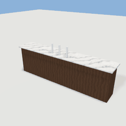
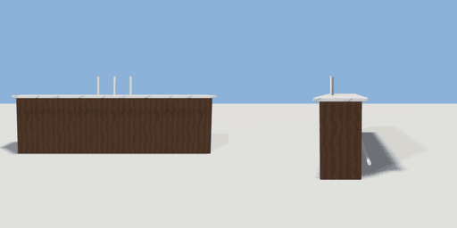

# bar_counter

`asset: bar_counter.yaml` · [source](../../../assets/bar_counter.yaml) · `furniture.bar_counter` `furniture.counter`

 

A bar counter: a panelled front with a marble top, beer taps and a brass
foot rail. Its +Z side is the staff side (it faces the back bar across the
aisle: room_types/bar.yaml places it front_of back_bar); customers sit on
stools at the seat_N attachments on the -Z side.
Origin: bottom centre.

```yaml
place:
  bar_counter: {asset: bar_counter.yaml, params: {width: 3.6}}
```

## Params

| Param | Default | Choices | Notes |
| --- | --- | --- | --- |
| `width` | `3.6` |  |  |

## Size

3.7 x 1.44 x 0.755 m (x, y, z); geometry (-1.85, 0, -0.405) to (1.85, 1.44, 0.35) from the origin; 588 triangles

## Parts

`counter` (cube), `counter_top` (cube), `foot_rail` (sweep), `tap_1` (cylinder), `tap_2` (cylinder), `tap_3` (cylinder)

## Attachments

| Attachment | Position | Facing |
| --- | --- | --- |
| `seat_1` | (-1.35, 0, -0.95) | north |
| `seat_2` | (-0.45, 0, -0.95) | north |
| `seat_3` | (0.45, 0, -0.95) | north |
| `seat_4` | (1.35, 0, -0.95) | north |

## Affordances

stand at (0, 0, 0.55) [staff, bar]

## Clearance

back 1.1
