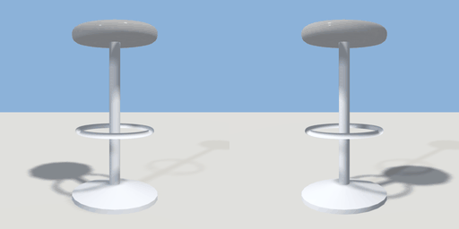

# bar_stool

`asset: bar_stool.yaml` · [source](../../../assets/bar_stool.yaml) · `furniture.stool` `furniture.bar_stool`

 

A bar stool: a turned chrome base and post, a footring, and a padded
round seat 76 cm up. Sitters face +Z (toward the counter when placed round one).

```yaml
place:
  bar_stool: {asset: bar_stool.yaml}
```

## Size

0.4 x 0.77 x 0.4 m (x, y, z); geometry (-0.2, 0, -0.2) to (0.2, 0.77, 0.2) from the origin; 2672 triangles

## Parts

`base` (lathe), `post` (cylinder), `footring` (torus), `seat` (cylinder)

## Affordances

sit at (0, 0.77, -0.02) height 0.77 [seat, bar]
