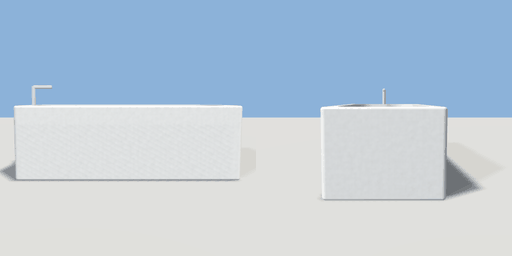

# bathtub

`asset: bathtub.yaml` · [source](../../../assets/bathtub.yaml) · `bathroom.bathtub`

 

Built-in bathtub: ceramic tub with a rounded, sloped-in cavity and a
chrome filler at the tap end (-X). Origin bottom_center, long side along X.

```yaml
place:
  bathtub: {asset: bathtub.yaml, params: {length: 1.7, width: 0.75}}
```

## Params

| Param | Default | Choices | Notes |
| --- | --- | --- | --- |
| `length` | `1.7` |  |  |
| `width` | `0.75` |  |  |
| `height` | `0.56` |  |  |
| `rim` | `0.07` |  |  |

## Size

1.7 x 0.76 x 0.75 m (x, y, z); geometry (-0.85, 0, -0.375) to (0.85, 0.726, 0.375) from the origin; 1088 triangles

## Parts

`tub` (extrude), `cavity` (extrude), `filler` (cylinder), `spout` (cube)

## Clearance

front 0.6
