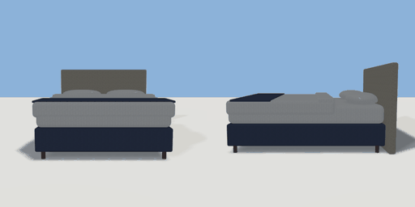

# bed

`asset: bed.yaml` · [source](../../../assets/bed.yaml) · `furniture.bed`

 

Hotel double bed: upholstered headboard, base on short legs, mattress,
duvet folded back at the head, and two pillows. Head at the back (-Z),
foot at the front (+Z); origin bottom_center.

```yaml
place:
  bed: {asset: bed.yaml, params: {width: 1.6, length: 2}}
```

## Params

| Param | Default | Choices | Notes |
| --- | --- | --- | --- |
| `width` | `1.6` |  | mattress width (1.6 = UK king / US queen) |
| `length` | `2` |  | mattress length |
| `headboard` | `1.15` |  | headboard height |
| `leg` | `0.1` |  |  |
| `base` | `0.28` |  | base (divan) height above the legs |
| `mattress` | `0.24` |  |  |
| `duvet_lift` | `0.035` |  | a sleeper lies on the duvet (which stands ~6 cm proud at the foot), part sunk in |
| `hb_depth` | `0.09` |  |  |

## Size

1.66 x 1.15 x 2.13 m (x, y, z); geometry (-0.835, 0, -1.065) to (0.835, 1.15, 1.065) from the origin; 2952 triangles

## Parts

`headboard` (cube), `base` (cube), `mattress` (cube), `duvet` (cube), `duvet_fold` (cube), `throw` (cube), `pillow_left` (cube), `pillow_right` (cube), `leg_fl` (cylinder), `leg_fr` (cylinder), `leg_bl` (cylinder), `leg_br` (cylinder)

## Attachments

| Attachment | Position | Facing |
| --- | --- | --- |
| `nightstand_left` | (-1.13, 0, -0.765) | north |
| `nightstand_right` | (1.13, 0, -0.765) | north |
| `foot` | (0, 0, 1.415) | north |

## Surfaces

| Surface | Size (u x v, m) | Facing |
| --- | --- | --- |
| `mattress` | 1.58 x 1.98 | +Y |

## Affordances

- lie at (-0.4, 0.655, 0.1) height 0.655 [bed]
- lie at (0.4, 0.655, 0.1) height 0.655 [bed]
- sit at (0, 0.62, 0.765) height 0.62

## Clearance

left 0.75, right 0.75, front 0.7
