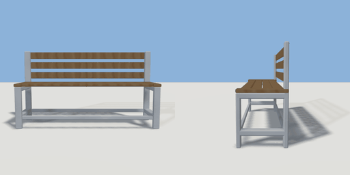

# bench

`asset: bench.yaml` · [source](../../../assets/bench.yaml) · `furniture.bench`

 

Park bench with metal frame and wood slats
Origin is at bottom_center
All measurements carefully calculated so parts connect
(Scales proportionally — a 2m-long bench keeps the same slat count.)

```yaml
place:
  bench: {asset: bench.yaml, params: {length: 1.2, height: 0.85}}
```

## Params

| Param | Default | Choices | Notes |
| --- | --- | --- | --- |
| `length` | `1.2` |  |  |
| `height` | `0.85` |  |  |
| `depth` | `0.65` |  |  |

## Size

1.2 x 0.85 x 0.65 m (x, y, z); geometry (-0.66, 0, -0.184) to (0.66, 0.722, 0.179) from the origin; 2052 triangles

## Parts

`leg_left_front` (cube), `leg_left_back` (cube), `left_side_rail_upper` (cube), `left_side_rail_lower` (cube), `leg_right_front` (cube), `leg_right_back` (cube), `right_side_rail_upper` (cube), `right_side_rail_lower` (cube), `front_cross_bar` (cube), `back_cross_bar` (cube), `seat_slat_1` (cube), `seat_slat_2` (cube), `seat_slat_3` (cube), `seat_slat_4` (cube), `back_slat_1` (cube), `back_slat_2` (cube), `back_slat_3` (cube), `armrest_left` (cube), `armrest_right` (cube)

## Affordances

- sit at (-0.3, 0.408, 0.05) height 0.408 [seat, outside]
- sit at (0.3, 0.408, 0.05) height 0.408 [seat, outside]
