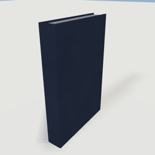
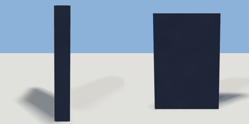

# book

`asset: book.yaml` · [source](../../../assets/book.yaml) · `prop.book`

 

A book, standing upright as on a shelf: two boards and a spine round a block of pages. A
carryable physics prop that NPCs read (geogen.104): its `read` affordance follows the book
wherever it lies; the action takes it, reads it and puts it back where it was
(npcs/actions.yaml `read`). Origin: bottom centre; the spine faces +Z (out of a shelf).

```yaml
place:
  book: {asset: book.yaml, params: {thickness: 0.032, height: 0.235}, state: open}
```

## Params

| Param | Default | Choices | Notes |
| --- | --- | --- | --- |
| `thickness` | `0.032` |  | m across the spine |
| `height` | `0.235` |  |  |
| `depth` | `0.16` |  | spine to fore-edge |
| `colour` | `paint_navy` | text |  |
| `board` | `0.003` |  | m the boards are thick |

## Size

0.032 x 0.235 x 0.16 m (x, y, z); geometry (-0.016, 0, -0.08) to (0.016, 0.235, 0.08) from the origin; 252 triangles

## Parts

`back_board` (cube), `front_board` (cube), `spine` (cube), `pages_back` (cube), `pages_front` (cube)

## Interactions

book: closed* -> open, open -> closed (* initial; rotates back_board, pages_back; rotates front_board, pages_front)

## Affordances

look at (0, 0.117, 0.08) [book]
