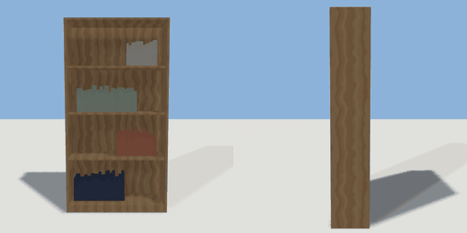

# bookshelf

`asset: bookshelf.yaml` · [source](../../../assets/bookshelf.yaml) · `furniture.bookshelf`

 

Open bookshelf: wooden carcass with back panel, four shelves and rows of
books. Origin bottom_center, open front faces +Z (stand it against a wall).

```yaml
place:
  bookshelf: {asset: bookshelf.yaml, params: {width: 1, height: 1.9}}
```

## Params

| Param | Default | Choices | Notes |
| --- | --- | --- | --- |
| `width` | `1` |  |  |
| `height` | `1.9` |  |  |
| `depth` | `0.34` |  |  |
| `board` | `0.022` |  | panel thickness |
| `plinth` | `0.08` |  |  |

## Size

1 x 1.9 x 0.34 m (x, y, z); geometry (-0.5, 0, -0.17) to (0.5, 1.9, 0.17) from the origin; 1632 triangles

## Parts

`side_left` (cube), `side_right` (cube), `top` (cube), `plinth` (cube), `back_panel` (cube), `shelf_1` (cube), `shelf_2` (cube), `shelf_3` (cube), `books_1` (extrude), `books_2` (extrude), `books_3` (extrude), `books_4` (extrude)

## Surfaces

| Surface | Size (u x v, m) | Facing |
| --- | --- | --- |
| `top` | 0.956 x 0.34 | +Y |

## Affordances

look at (0, 0, 0.62) [shelf]

## Clearance

front 0.6
