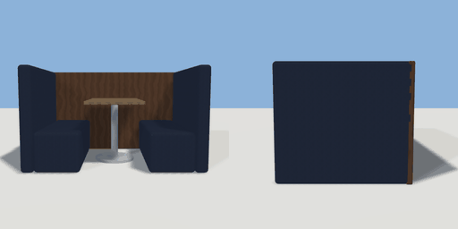

# booth

`asset: booth.yaml` · [source](../../../assets/booth.yaml) · `furniture.booth` `furniture.table`

 

A restaurant booth: a table between two high-backed upholstered benches.
The booth's closed end (-Z) goes against a wall; you slide in from the
open end (+Z), so each seat's approach is out in front of the booth.

```yaml
place:
  booth: {asset: booth.yaml}
```

## Size

2.02 x 1.15 x 1.3 m (x, y, z); geometry (-1.01, 0, -0.65) to (1.01, 1.15, 0.65) from the origin; 1592 triangles

## Parts

`table` (cube), `table_leg` (cylinder), `table_foot` (cylinder), `seat_west` (cube), `seat_east` (cube), `back_west` (cube), `back_east` (cube), `end_panel` (cube)

## Affordances

- sit at (-0.6, 0.46, 0.3) height 0.46 [seat, dining]
- sit at (-0.6, 0.46, -0.3) height 0.46 [seat, dining]
- sit at (0.6, 0.46, 0.3) height 0.46 [seat, dining]
- sit at (0.6, 0.46, -0.3) height 0.46 [seat, dining]

## Clearance

front 0.9
