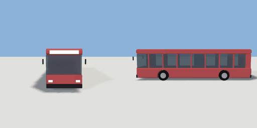

# bus

`asset: vehicles/bus.yaml` · [source](../../../assets/vehicles/bus.yaml) · `vehicle.bus`

 

A single-deck city bus: flat front, a continuous window band with painted
pillars, doors on the right (kerb side for right-hand traffic; -X). Built
along +Z, origin on the ground midway between the axles, left = +X, parts
in metres (unit container, `bounds: geometry`). Paint is a vertex tint.

```yaml
place:
  bus: {asset: vehicles/bus.yaml, params: {paint: silver, length: 11}}
```

## Params

| Param | Default | Choices | Notes |
| --- | --- | --- | --- |
| `length` | `11` |  |  |
| `width` | `2.5` |  |  |
| `height` | `3.05` |  |  |
| `wheelbase` | `5.9` |  |  |
| `wheel_r` | `0.5` |  |  |
| `tyre_w` | `0.3` |  |  |
| `belt` | `1.25` |  |  |
| `window_top` | `2.6` |  |  |
| `pane` | `1.35` |  | pillar spacing along the window band |
| `paint` | `bus_red` | bus_red, car_white, car_blue, british_green, taxi_yellow, orange, silver |  |

## Size

2.94 x 3.05 x 11.28 m (x, y, z); geometry (-1.47, 0, -5.54) to (1.47, 3.05, 5.74) from the origin; 10032 triangles

## Parts

`body` (extrude), `arch_front` (cylinder), `arch_rear` (cylinder), `window_band` (cube), `roof` (extrude), `pillar_1` (cube), `pillar_2` (cube), `pillar_3` (cube), `pillar_4` (cube), `pillar_5` (cube), `pillar_6` (cube), `pillar_7` (cube), `pillar_rear` (cube), `door_front` (cube), `door_mid` (cube), `destination` (cube), `bumper_front` (cube), `bumper_rear` (cube), `headlight_left` (cube), `headlight_right` (cube), `taillight_left` (cube), `taillight_right` (cube), `mirror_left` (cube), `mirror_right` (cube), `wheel_fl` (cylinder), `wheel_fr` (cylinder), `wheel_rl` (cylinder), `wheel_rr` (cylinder), `hub_fl` (cylinder), `hub_fr` (cylinder), `hub_rl` (cylinder), `hub_rr` (cylinder)

## Vehicle

class bus, max_speed 12, turn_radius 9, accel 2, decel 4, wheelbase 5.9, track 2.11, clearance [11.28,2.94,3.05]
