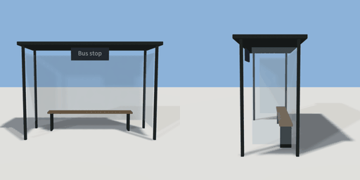

# bus_shelter

`asset: bus_shelter.yaml` · [source](../../../assets/bus_shelter.yaml) · `street.bus_stop` `street_furniture`

 

A bus shelter: a steel frame with a glass back and ends, a flat roof, a
perch bench and a timetable panel with the stop's name. Faces +Z (the kerb).

```yaml
place:
  bus_shelter: {asset: bus_shelter.yaml, params: {label: Bus stop, width: 3.2}}
```

## Params

| Param | Default | Choices | Notes |
| --- | --- | --- | --- |
| `label` | `Bus stop` | text |  |
| `width` | `3.2` |  |  |

## Size

3.4 x 2.38 x 1.4 m (x, y, z); geometry (-1.7, 0, -0.7) to (1.7, 2.38, 0.7) from the origin; 2780 triangles

## Parts

`post_1` (cube), `post_2` (cube), `post_3` (cube), `post_4` (cube), `roof` (cube), `back_glass` (cube), `end_glass_l` (cube), `end_glass_r` (cube), `bench` (cube), `bench_leg_l` (cube), `bench_leg_r` (cube), `panel` (cube), `panel_label` (text)

## Affordances

- sit at (-0.5, 0.55, -0.3) height 0.55 [seat, outside, bus]
- sit at (0.5, 0.55, -0.3) height 0.55 [seat, outside, bus]

## Clearance

front 1
