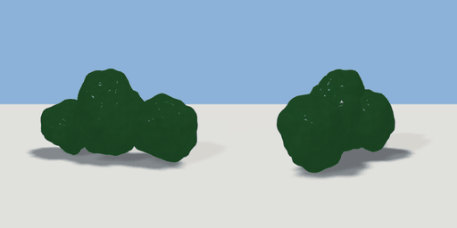

# bush

`asset: bush.yaml` · [source](../../../assets/bush.yaml) · `vegetation.bush`

 

Bush/shrub - cluster of overlapping spheres, noise-displaced into lumpy foliage
Origin at bottom_center

```yaml
place:
  bush: {asset: bush.yaml, params: {width: 0.8, height: 0.6}}
```

## Params

| Param | Default | Choices | Notes |
| --- | --- | --- | --- |
| `width` | `0.8` |  |  |
| `height` | `0.6` |  |  |
| `depth` | `0.8` |  |  |

## Size

0.8 x 0.6 x 0.8 m (x, y, z); geometry (-0.342, 0.02, -0.285) to (0.387, 0.445, 0.217) from the origin; 18464 triangles

## Parts

`center` (sphere), `left` (sphere), `right` (sphere), `top` (sphere), `back` (sphere)
