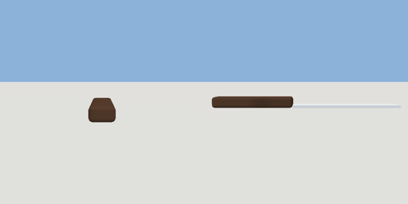

# butter_knife

`asset: butter_knife.yaml` · [source](../../../assets/butter_knife.yaml) · `decor.cutlery`

 

A butter knife lying flat, handle toward +Z. Origin: under its middle.

```yaml
place:
  butter_knife: {asset: butter_knife.yaml}
```

## Size

0.02 x 0.012 x 0.21 m (x, y, z); geometry (-0.01, 0, -0.105) to (0.01, 0.012, 0.105) from the origin; 120 triangles

## Parts

`blade` (cube), `handle` (cube)
