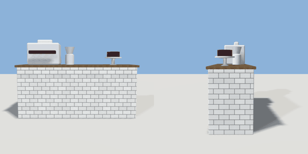

# cafe_counter

`asset: cafe_counter.yaml` · [source](../../../assets/cafe_counter.yaml) · `shop.cafe_counter` `furniture.counter`

 

A cafe counter: a tiled counter with an espresso machine, a grinder, a
cake stand and cups. Staff stand behind it (-Z), customers order in front.

```yaml
place:
  cafe_counter: {asset: cafe_counter.yaml, params: {width: 2.2}}
```

## Params

| Param | Default | Choices | Notes |
| --- | --- | --- | --- |
| `width` | `2.2` |  |  |

## Size

2.26 x 1.49 x 0.7 m (x, y, z); geometry (-1.13, 0, -0.35) to (1.13, 1.49, 0.35) from the origin; 1376 triangles

## Parts

`body` (cube), `top` (cube), `machine` (cube), `group_heads` (cube), `grinder` (lathe), `cake_stand` (lathe), `cake` (cylinder), `cups` (cube)

## Affordances

stand at (0, 0, -0.75) [staff, shop]

## Clearance

front 1, back 0.8
