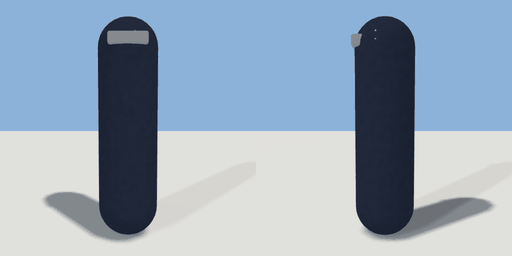

# capsule

`asset: characters/capsule.yaml` · [source](../../../assets/characters/capsule.yaml) · `npc.body`

 

Placeholder character body: a capsule with a visor showing which way it
faces (+Z). NPC definitions name a body asset; the humanoid generator will
replace this one without changing anything else.

`poses:` place the body relative to an anchor (feet for stand, the hips on
a seat for sit, the mattress for lie): offset in metres (anchor frame: x
right, y up, z forward), rotation in degrees, scale. The runtime applies
them as-is; a jointed body will define the same pose names as joint sets.

```yaml
place:
  capsule: {asset: characters/capsule.yaml, params: {height: 1.75, radius: 0.24}}
```

## Params

| Param | Default | Choices | Notes |
| --- | --- | --- | --- |
| `height` | `1.75` |  |  |
| `radius` | `0.24` |  |  |

## Size

0.48 x 1.75 x 0.48 m (x, y, z); geometry (-0.24, 0, -0.24) to (0.24, 1.75, 0.254) from the origin; 1260 triangles

## Parts

`body` (capsule), `visor` (cube)

## Poses

lie, sit, stand
