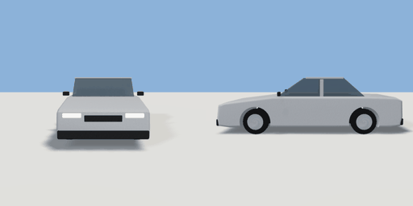

# car

`asset: vehicles/car.yaml` · [source](../../../assets/vehicles/car.yaml) · `vehicle.car`

 

A parametric car: sedan, hatchback, estate or taxi (presets). Built along +Z
(the front) with the origin on the ground midway between the axles; left is
+X. Parts are in metres (a unit container with `bounds: geometry`).

The body is a side profile extruded across the width (axis x maps profile
x to -Z, so profile points are written [-z, y]), with the wheel arches cut
out; the glasshouse is a narrower extrusion in tinted glass with a painted
roof. Paint is a vertex tint (`paint` param) over one neutral material.

```yaml
place:
  car: {asset: vehicles/car.yaml, params: {preset: hatchback, paint: orange}}
```

## Params

| Param | Default | Choices | Notes |
| --- | --- | --- | --- |
| `length` | `4.6` |  |  |
| `width` | `1.8` |  |  |
| `wheelbase` | `2.7` |  |  |
| `wheel_r` | `0.32` |  |  |
| `tyre_w` | `0.21` |  |  |
| `belt` | `0.95` |  | top of the doors |
| `hood` | `0.8` |  | front edge of the bonnet |
| `deck` | `0.93` |  | rear edge of the boot lid (or hatch) |
| `roof` | `1.44` |  |  |
| `screen_z` | `0.85` |  | windscreen base (z) |
| `roof_f` | `0.15` |  | roof front / rear (z) |
| `roof_r` | `-0.85` |  |  |
| `back_z` | `-1.4` |  | rear window base (z); keep > -(length / 2 - 0.16) |
| `taxi` | `0` |  | 1: roof sign |
| `paint` | `silver` | car_white, silver, graphite, car_black, car_red, maroon, car_blue, car_navy, teal_green, british_green, beige, taxi_yellow, orange |  |

## Size

2.02 x 1.435 x 4.64 m (x, y, z); geometry (-1.01, 0, -2.32) to (1.01, 1.435, 2.32) from the origin; 7156 triangles

## Presets

- sedan: defaults
- hatchback: length=4.05, wheelbase=2.55, deck=0.98, roof=1.46, screen_z=0.75, roof_f=0.05, roof_r=-1.55, back_z=-1.8
- estate: length=4.75, wheelbase=2.75, deck=0.98, roof_r=-1.95, back_z=-2.15
- taxi: paint=taxi_yellow, taxi=1

## Parts

`body` (extrude), `arch_front` (cylinder), `arch_rear` (cylinder), `glasshouse` (extrude), `roof_panel` (cube), `b_pillar` (cube), `bumper_front` (cube), `bumper_rear` (cube), `grille` (cube), `headlight_left` (cube), `headlight_right` (cube), `taillight_left` (cube), `taillight_right` (cube), `mirror_left` (cube), `mirror_right` (cube), `taxi_sign` (cube), `wheel_fl` (cylinder), `wheel_fr` (cylinder), `wheel_rl` (cylinder), `wheel_rr` (cylinder), `hub_fl` (cylinder), `hub_fr` (cylinder), `hub_rl` (cylinder), `hub_rr` (cylinder)

## Vehicle

class car, max_speed 16, turn_radius 5.5, accel 2, decel 4, wheelbase 2.7, track 1.54, clearance [4.64,2.02,1.435]
