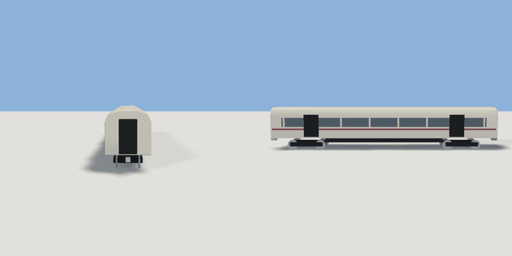

# carriage

`asset: vehicles/carriage.yaml` · [source](../../../assets/vehicles/carriage.yaml) · `vehicle.rail` `vehicle.carriage`

 

A passenger carriage: a long body with a rounded roof, a window band, two
doors a side and two bogies. Built along +Z; the origin is on the rail head
midway between the bogies (y = 0 is the top of the rails), left = +X. Parts
in metres (unit container, `bounds: geometry`). The bogies turn on their own
to follow the track (vehicle: bogies), carrying their wheels.

```yaml
place:
  carriage: {asset: vehicles/carriage.yaml, params: {paint: maroon, stripe: graphite}}
```

## Params

| Param | Default | Choices | Notes |
| --- | --- | --- | --- |
| `length` | `20` |  |  |
| `width` | `2.8` |  |  |
| `bogie_gap` | `14` |  | between bogie centres |
| `wheel_r` | `0.46` |  |  |
| `gauge` | `1.435` |  |  |
| `floor` | `1.15` |  | body floor above the rail head |
| `paint` | `cream` | cream, car_white, silver, car_red, bus_red, british_green, car_navy, maroon |  |
| `stripe` | `maroon` | maroon, car_red, car_navy, british_green, taxi_yellow, graphite |  |

## Size

2.85 x 3.87 x 20.9 m (x, y, z); geometry (-1.425, 0, -10.45) to (1.425, 3.87, 10.45) from the origin; 3968 triangles

## Parts

`body` (extrude), `window_band` (cube), `stripe` (cube), `pillar_1` (cube), `pillar_2` (cube), `pillar_3` (cube), `pillar_4` (cube), `pillar_5` (cube), `pillar_6` (cube), `pillar_7` (cube), `pillar_8` (cube), `door_front` (cube), `door_rear` (cube), `underframe` (cube), `gangway_front` (cube), `gangway_rear` (cube), `coupler_front` (cube), `coupler_rear` (cube), `bogie_front` (cube), `bogie_rear` (cube), `wheel_ff_l` (cylinder), `wheel_ff_r` (cylinder), `wheel_fr_l` (cylinder), `wheel_fr_r` (cylinder), `wheel_rf_l` (cylinder), `wheel_rf_r` (cylinder), `wheel_rr_l` (cylinder), `wheel_rr_r` (cylinder)

## Vehicle

class carriage, max_speed 30, turn_radius 150, accel 2, decel 4, wheelbase 16.5, track 1.495, clearance [20.9,2.85,3.87]
