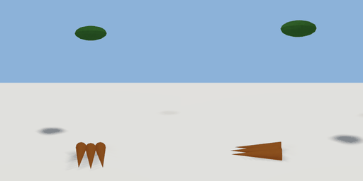

# carrot_bunch

`asset: carrot_bunch.yaml` · [source](../../../assets/carrot_bunch.yaml) · `prop.crop`

 

A bunch of carrots: three orange roots side by side with their green tops. The body of
items/carrot.yaml (a carryable physics prop). Origin: bottom centre; lying along Z,
tops at -Z.

```yaml
place:
  carrot_bunch: {asset: carrot_bunch.yaml}
```

## Size

0.12 x 0.465 x 0.295 m (x, y, z); geometry (-0.06, 0.085, -0.12) to (0.06, 0.55, 0.175) from the origin; 296 triangles

## Parts

`root_1` (cone), `root_2` (cone), `root_3` (cone), `tops` (ellipsoid)
