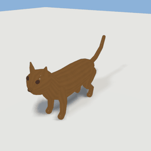
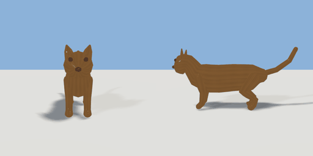

# cat

`asset: characters/cat.yaml` · [source](../../../assets/characters/cat.yaml) · `npc.body` `animal.cat`

 

A cat: a four-legged skinned body with a walk and an idle, all from YAML.

The quadruped skeleton (assets/skeletons/quadruped.yaml) skinned by
ring-lofted chains, like the humanoid (generators/ringloft.py): one closed
mesh, stylised and low-poly. Faces +Z; origin on the floor under the middle
of the body.

Ring frames: the trunk and tail have side = +X (rx = half width) and front =
up (rz = half height); legs have side = +X, front = +Z.

```yaml
place:
  cat: {asset: characters/cat.yaml, params: {coat: cream, size: 1}}
```

## Params

| Param | Default | Choices | Notes |
| --- | --- | --- | --- |
| `size` | `1` |  | 1: a house cat, 25 cm at the shoulder |
| `build` | `0.5` |  | 0 lean .. 1 stocky |
| `coat` | `ginger` | ginger, grey, black, white, brown, cream |  |

## Size

0.149 x 0.34 x 0.781 m (x, y, z); geometry (-0.075, -0.001, -0.391) to (0.075, 0.34, 0.298) from the origin; 2220 triangles

## Poses

stand

## Clips

idle, pose_stand, walk
