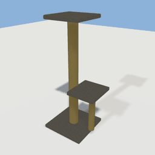
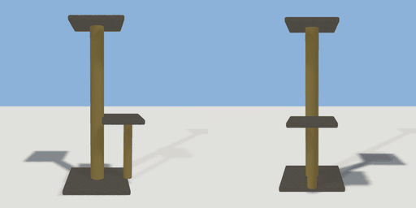

# cat_tree

`asset: cat_tree.yaml` · [source](../../../assets/cat_tree.yaml) · `furniture.cat_tree`

 

A cat tree: a sisal-wrapped post on a base board, a platform half-way up to
one side and a top platform over the post. Cats jump onto the low platform
and climb the post to the top one, which is out of their jumping reach (its
perch's `climb`, geogen.100.7), and nap up there. Origin: bottom centre; the
low platform is to the +X side, the climbing face of the post faces +Z.

```yaml
place:
  cat_tree: {asset: cat_tree.yaml, params: {height: 1.3, low: 0.55}}
```

## Params

| Param | Default | Choices | Notes |
| --- | --- | --- | --- |
| `height` | `1.3` |  | the top platform's top |
| `low` | `0.55` |  | the low platform's top |
| `post` | `0.11` |  | post diameter |

## Size

0.75 x 1.3 x 0.5 m (x, y, z); geometry (-0.25, 0, -0.25) to (0.36, 1.3, 0.25) from the origin; 428 triangles

## Parts

`base` (cube), `post` (cylinder), `low_post` (cylinder), `low_platform` (cube), `top_platform` (cube)

## Affordances

- perch at (0.22, 0.55, 0) [animal, comfy]
- perch at (0, 1.3, 0) [animal, comfy, high]
