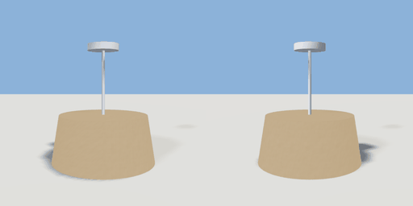

# ceiling_light

`asset: ceiling_light.yaml` · [source](../../../assets/ceiling_light.yaml) · `light.ceiling`

 

Ceiling pendant: a canopy, a thin stem and a tapered shade. It hangs below
its origin, so place it at the underside of a ceiling.

```yaml
place:
  ceiling_light: {asset: ceiling_light.yaml, params: {drop: 0.45, shade: 0.4}}
```

## Params

| Param | Default | Choices | Notes |
| --- | --- | --- | --- |
| `drop` | `0.45` |  | ceiling to the bottom of the shade |
| `shade` | `0.4` |  | shade diameter |

## Size

0.4 x 0.45 x 0.4 m (x, y, z); geometry (-0.2, -0.45, -0.2) to (0.2, 0, 0.2) from the origin; 496 triangles

## Parts

`canopy` (cylinder), `stem` (cylinder), `shade` (lathe)

## Light

type omni, color [1,0.93,0.82], energy 1.2, range 6, offset [0,-0.47,0]
