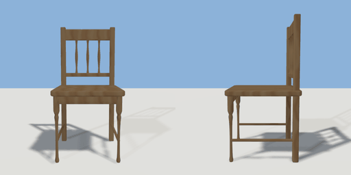

# chair

`asset: chair.yaml` · [source](../../../assets/chair.yaml) · `furniture.chair`

 

Dining chair: filleted seat, turned front legs, back posts with rails and
spindles, and side stretchers.
Origin is at bottom_center of bounding box. The chair faces +Z.

```yaml
place:
  chair: {asset: chair.yaml, params: {width: 0.46, height: 0.92}}
```

## Params

| Param | Default | Choices | Notes |
| --- | --- | --- | --- |
| `width` | `0.46` |  |  |
| `height` | `0.92` |  |  |
| `depth` | `0.48` |  |  |
| `seat_height` | `0.46` |  |  |
| `seat_thickness` | `0.035` |  |  |
| `leg_width` | `0.038` |  |  |
| `leg_inset` | `0.035` |  | leg centre distance from the seat edge |
| `at_table` | `1` |  | NPCs sit with their forearms on the table (sit_at_table); 0: hands in the lap |

## Size

0.46 x 0.92 x 0.48 m (x, y, z); geometry (-0.23, 0, -0.24) to (0.23, 0.92, 0.24) from the origin; 4064 triangles

## Parts

`seat` (extrude), `leg_front_left` (lathe), `leg_front_right` (lathe), `post_left` (extrude), `post_right` (extrude), `top_rail` (extrude), `mid_rail` (cube), `spindle_left` (lathe), `spindle_center` (lathe), `spindle_right` (lathe), `apron_front` (cube), `stretcher_left` (cylinder), `stretcher_right` (cylinder)

## Surfaces

| Surface | Size (u x v, m) | Facing |
| --- | --- | --- |
| `seat` | 0.46 x 0.48 | +Y |

## Affordances

sit at (0, 0.46, 0.03) height 0.46 [seat, table]
