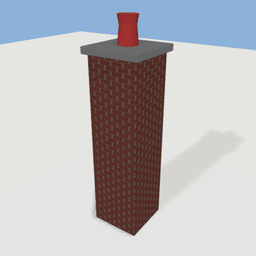
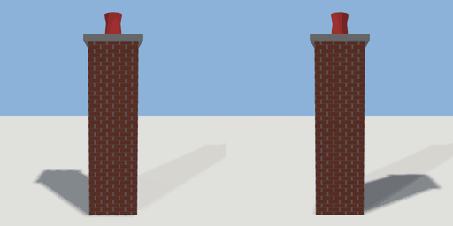

# chimney_stack

`asset: chimney_stack.yaml` · [source](../../../assets/chimney_stack.yaml) · `decor.chimney`

 

A free-standing brick chimney stack with a clay pot, giving off a slow drift of smoke.
Bind or set `pot.running` to put it out. Origin: bottom centre.

```yaml
place:
  chimney_stack: {asset: chimney_stack.yaml, params: {height: 3.2}}
```

## Params

| Param | Default | Choices | Notes |
| --- | --- | --- | --- |
| `height` | `3.2` |  |  |

## Size

1.05 x 3.78 x 1.05 m (x, y, z); geometry (-0.525, 0, -0.525) to (0.525, 3.78, 0.525) from the origin; 456 triangles

## Parts

`stack` (cube), `cap` (cube), `pot` (lathe)
