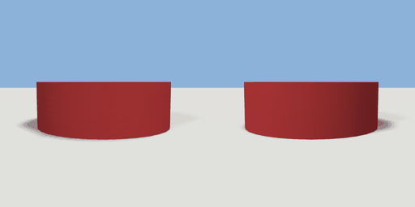

# christmas_tree

`asset: christmas_tree.yaml` · [source](../../../assets/christmas_tree.yaml) · `decor.christmas`

 

A Christmas tree and everything that goes with decorating it (geogen.110): a stand that is
always there, the tree once it has been set up, a box of 20 ornaments put down beside it, and
20 spots on the boughs, each showing its ornament once one is hung there. The tree is decorated
when all 20 are on it: only then can its fairy lights be plugged in.

Nothing here says what order to do this in. Each affordance says what it needs and what it
leaves behind, and people who want the tree decorated (a `tree_decorated` need) plan the rest.
Each spot's ornament starts in the box, so the box empties as the tree fills. They are hung from
seven places round the tree: the `uses` of one place share it, so two people never stand together.
Origin: the middle of the stand, on the floor. The front is +Z.

```yaml
place:
  christmas_tree: {asset: christmas_tree.yaml, state: {tree: up}}
```

## Size

2.185 x 2.12 x 1.25 m (x, y, z); geometry (-0.21, 0, -0.21) to (0.21, 0.14, 0.21) from the origin; 128 triangles

## Parts

`stand` (cylinder), `trunk` (cylinder), `boughs_0` (cone), `boughs_1` (cone), `boughs_2` (cone), `boughs_3` (cone), `boughs_4` (cone), `boughs_5` (cone), `star` (ellipsoid), `box` (cube), `boxed_0` (sphere), `boxed_1` (sphere), `boxed_2` (sphere), `boxed_3` (sphere), `boxed_4` (sphere), `boxed_5` (sphere), `boxed_6` (sphere), `boxed_7` (sphere), `boxed_8` (sphere), `boxed_9` (sphere), `boxed_10` (sphere), `boxed_11` (sphere), `boxed_12` (sphere), `boxed_13` (sphere), `boxed_14` (sphere), `boxed_15` (sphere), `boxed_16` (sphere), `boxed_17` (sphere), `boxed_18` (sphere), `boxed_19` (sphere), `ornament_0` (sphere), `ornament_1` (sphere), `ornament_2` (sphere), `ornament_3` (sphere), `ornament_4` (sphere), `ornament_5` (sphere), `ornament_6` (sphere), `ornament_7` (sphere), `ornament_8` (sphere), `ornament_9` (sphere), `ornament_10` (sphere), `ornament_11` (sphere), `ornament_12` (sphere), `ornament_13` (sphere), `ornament_14` (sphere), `ornament_15` (sphere), `ornament_16` (sphere), `ornament_17` (sphere), `ornament_18` (sphere), `ornament_19` (sphere), `bulb_0` (sphere), `bulb_1` (sphere), `bulb_2` (sphere), `bulb_3` (sphere), `bulb_4` (sphere), `bulb_5` (sphere), `bulb_6` (sphere), `bulb_7` (sphere), `bulb_8` (sphere), `bulb_9` (sphere), `bulb_10` (sphere), `bulb_11` (sphere), `bulb_12` (sphere), `bulb_13` (sphere), `bulb_14` (sphere), `bulb_15` (sphere), `bulb_16` (sphere), `bulb_17` (sphere)

## Attachments

| Attachment | Position | Facing |
| --- | --- | --- |
| `spot_0` | (-0.348, 0.943, -0.127) | center |
| `spot_1` | (-0.29, 1.216, -0.005) | center |
| `spot_2` | (-0.205, 1.472, -0.047) | center |
| `spot_3` | (-0.361, 0.943, 0.083) | center |
| `spot_4` | (-0.246, 1.216, 0.154) | center |
| `spot_5` | (-0.197, 1.472, 0.072) | center |
| `spot_6` | (-0.252, 0.943, 0.271) | center |
| `spot_7` | (-0.118, 1.216, 0.265) | center |
| `spot_8` | (-0.123, 1.472, 0.17) | center |
| `spot_9` | (-0.064, 0.943, 0.364) | center |
| `spot_10` | (0.045, 1.216, 0.286) | center |
| `spot_11` | (0.145, 0.943, 0.341) | center |
| `spot_12` | (0.194, 1.216, 0.216) | center |
| `spot_13` | (0.105, 1.472, 0.182) | center |
| `spot_14` | (0.31, 0.943, 0.202) | center |
| `spot_15` | (0.281, 1.216, 0.07) | center |
| `spot_16` | (0.189, 1.472, 0.092) | center |
| `spot_17` | (0.37, 0.943, 0) | center |
| `spot_18` | (0.274, 1.216, -0.094) | center |
| `spot_19` | (0.208, 1.472, -0.026) | center |

## Interactions

- tree: absent*, up (* initial; shows/hides trunk, boughs_0, boughs_1, boughs_2, boughs_3, boughs_4, boughs_5, star)
- box: away*, out (* initial; shows/hides box)
- fairy: dark*, glowing (* initial; shows/hides bulb_0, bulb_1, bulb_2, bulb_3, bulb_4, bulb_5, bulb_6, bulb_7, bulb_8, bulb_9, bulb_10, bulb_11, bulb_12, bulb_13, bulb_14, bulb_15, bulb_16, bulb_17)
- hook_0: waiting*, boxed -> hung, hung (* initial; shows/hides boxed_0; shows/hides ornament_0)
- hook_1: waiting*, boxed -> hung, hung (* initial; shows/hides boxed_1; shows/hides ornament_1)
- hook_2: waiting*, boxed -> hung, hung (* initial; shows/hides boxed_2; shows/hides ornament_2)
- hook_3: waiting*, boxed -> hung, hung (* initial; shows/hides boxed_3; shows/hides ornament_3)
- hook_4: waiting*, boxed -> hung, hung (* initial; shows/hides boxed_4; shows/hides ornament_4)
- hook_5: waiting*, boxed -> hung, hung (* initial; shows/hides boxed_5; shows/hides ornament_5)
- hook_6: waiting*, boxed -> hung, hung (* initial; shows/hides boxed_6; shows/hides ornament_6)
- hook_7: waiting*, boxed -> hung, hung (* initial; shows/hides boxed_7; shows/hides ornament_7)
- hook_8: waiting*, boxed -> hung, hung (* initial; shows/hides boxed_8; shows/hides ornament_8)
- hook_9: waiting*, boxed -> hung, hung (* initial; shows/hides boxed_9; shows/hides ornament_9)
- hook_10: waiting*, boxed -> hung, hung (* initial; shows/hides boxed_10; shows/hides ornament_10)
- hook_11: waiting*, boxed -> hung, hung (* initial; shows/hides boxed_11; shows/hides ornament_11)
- hook_12: waiting*, boxed -> hung, hung (* initial; shows/hides boxed_12; shows/hides ornament_12)
- hook_13: waiting*, boxed -> hung, hung (* initial; shows/hides boxed_13; shows/hides ornament_13)
- hook_14: waiting*, boxed -> hung, hung (* initial; shows/hides boxed_14; shows/hides ornament_14)
- hook_15: waiting*, boxed -> hung, hung (* initial; shows/hides boxed_15; shows/hides ornament_15)
- hook_16: waiting*, boxed -> hung, hung (* initial; shows/hides boxed_16; shows/hides ornament_16)
- hook_17: waiting*, boxed -> hung, hung (* initial; shows/hides boxed_17; shows/hides ornament_17)
- hook_18: waiting*, boxed -> hung, hung (* initial; shows/hides boxed_18; shows/hides ornament_18)
- hook_19: waiting*, boxed -> hung, hung (* initial; shows/hides boxed_19; shows/hides ornament_19)

## Affordances

- stand at (0, 0, 0.9) [errand]
- stand at (1.9, 0, -0.1) [errand]
- stand at (1.35, 0, 0.55)
- stand at (1.35, 0, -0.75)
- stand at (-0.788, 0, -0.139)
- stand at (-0.736, 0, 0.313)
- stand at (-0.436, 0, 0.671)
- stand at (0, 0, 0.8)
- stand at (0.436, 0, 0.671)
- stand at (0.736, 0, 0.313)
- stand at (0.788, 0, -0.139)
- stand at (-1.05, 0, 0.2) [errand]
- stand at (0.55, 0, 2.3)
- stand at (-0.55, 0, 2.3)

## Light

type omni, color [1,0.78,0.45], energy 1.1, range 4, offset [0,1.15,0.6]
