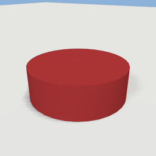

# christmas_tree

`asset: christmas_tree.yaml` · [source](../../../assets/christmas_tree.yaml) · `decor.christmas`

 

A Christmas tree and everything that goes with decorating it (geogen.110): a stand that is
always there, the tree once it has been set up, the box of ornaments put down beside it, and
twelve hooks that each show their ornament when one is hung.

Nothing here says what order to do this in. Each affordance says what it needs and what it
leaves behind, and people who want the tree decorated (a `tree_decorated` need) plan the rest.
Origin: the middle of the stand, on the floor. The front is +Z.

```yaml
place:
  christmas_tree: {asset: christmas_tree.yaml, state: {tree: up}}
```

## Size

2.155 x 2.12 x 1.25 m (x, y, z); geometry (-0.21, 0, -0.21) to (0.21, 0.14, 0.21) from the origin; 128 triangles

## Parts

`stand` (cylinder), `trunk` (cylinder), `boughs_0` (cone), `boughs_1` (cone), `boughs_2` (cone), `boughs_3` (cone), `boughs_4` (cone), `boughs_5` (cone), `star` (ellipsoid), `box` (cube), `box_ornament_0` (sphere), `box_ornament_1` (sphere), `box_ornament_2` (sphere), `ornament_0` (sphere), `ornament_1` (sphere), `ornament_2` (sphere), `ornament_3` (sphere), `ornament_4` (sphere), `ornament_5` (sphere), `ornament_6` (sphere), `ornament_7` (sphere), `ornament_8` (sphere), `ornament_9` (sphere), `ornament_10` (sphere), `ornament_11` (sphere)

## Interactions

- tree: absent*, up (* initial; shows/hides trunk, boughs_0, boughs_1, boughs_2, boughs_3, boughs_4, boughs_5, star)
- box: away*, out (* initial; shows/hides box, box_ornament_0, box_ornament_1, box_ornament_2)
- hook_0: empty*, hung (* initial; shows/hides ornament_0)
- hook_1: empty*, hung (* initial; shows/hides ornament_1)
- hook_2: empty*, hung (* initial; shows/hides ornament_2)
- hook_3: empty*, hung (* initial; shows/hides ornament_3)
- hook_4: empty*, hung (* initial; shows/hides ornament_4)
- hook_5: empty*, hung (* initial; shows/hides ornament_5)
- hook_6: empty*, hung (* initial; shows/hides ornament_6)
- hook_7: empty*, hung (* initial; shows/hides ornament_7)
- hook_8: empty*, hung (* initial; shows/hides ornament_8)
- hook_9: empty*, hung (* initial; shows/hides ornament_9)
- hook_10: empty*, hung (* initial; shows/hides ornament_10)
- hook_11: empty*, hung (* initial; shows/hides ornament_11)

## Affordances

- stand at (0, 0, 0.9) [errand]
- stand at (1.8, 0, -0.1) [errand]
- stand at (1.35, 0, 0.45)
- stand at (1.35, 0, -0.65)
- stand at (-0.846, 0, 0.308)
- stand at (-0.308, 0, 0.846)
- stand at (0.45, 0, 0.779)
- stand at (0.869, 0, 0.233)
- stand at (-0.636, 0, 0.636)
- stand at (0.078, 0, 0.897)
- stand at (0.737, 0, 0.516)
- stand at (-0.869, 0, 0.233)
- stand at (-0.233, 0, 0.869)
- stand at (0.579, 0, 0.689)
- stand at (-0.45, 0, 0.779)
- stand at (0.38, 0, 0.816)
