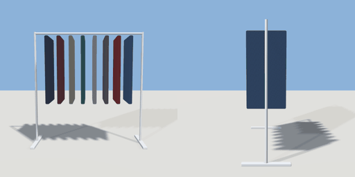

# clothes_rail

`asset: clothes_rail.yaml` · [source](../../../assets/clothes_rail.yaml) · `shop.clothes_rail`

 

A clothes rail: a chrome rail on two uprights with a row of garments on
hangers (thin boxes in mixed colours). Free-standing; runs along X.

```yaml
place:
  clothes_rail: {asset: clothes_rail.yaml, params: {length: 1.5}}
```

## Params

| Param | Default | Choices | Notes |
| --- | --- | --- | --- |
| `length` | `1.5` |  |  |

## Size

1.56 x 1.58 x 0.55 m (x, y, z); geometry (-0.78, 0, -0.275) to (0.78, 1.58, 0.275) from the origin; 1204 triangles

## Parts

`foot_l` (cube), `foot_r` (cube), `upright_l` (cylinder), `upright_r` (cylinder), `rail` (sweep), `garment_0` (cube), `garment_1` (cube), `garment_2` (cube), `garment_3` (cube), `garment_4` (cube), `garment_5` (cube), `garment_6` (cube), `garment_7` (cube)

## Clearance

front 0.8, back 0.8
