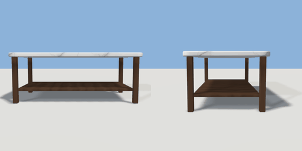

# coffee_table

`asset: coffee_table.yaml` · [source](../../../assets/coffee_table.yaml) · `furniture.table` `furniture.coffee_table`

 

Low coffee table: rounded top on four square legs with a lower shelf.
Origin bottom_center.

```yaml
place:
  coffee_table: {asset: coffee_table.yaml, params: {width: 1.1, depth: 0.6}}
```

## Params

| Param | Default | Choices | Notes |
| --- | --- | --- | --- |
| `width` | `1.1` |  |  |
| `depth` | `0.6` |  |  |
| `height` | `0.42` |  |  |

## Size

1.1 x 0.42 x 0.6 m (x, y, z); geometry (-0.55, 0, -0.3) to (0.55, 0.42, 0.3) from the origin; 1112 triangles

## Parts

`top` (extrude), `shelf` (cube), `leg_fl` (cube), `leg_fr` (cube), `leg_bl` (cube), `leg_br` (cube)

## Surfaces

| Surface | Size (u x v, m) | Facing |
| --- | --- | --- |
| `top` | 1.1 x 0.6 | +Y |

## Clearance

front 0.4, back 0.4
