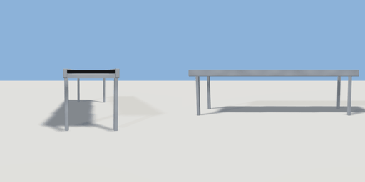

# conveyor

`asset: conveyor.yaml` · [source](../../../assets/conveyor.yaml) · `machine.conveyor`

 

A belt conveyor: a black rubber belt between steel rails on four legs. Its track carries
belt items (items/parcel.yaml) along the belt's top from the back (-Z) to the front (+Z);
put a source within half a metre of the back end to feed it, and line another belt's back
up with this one's front to pass items on (or `end:` sink | stop | drop). Origin: on the
floor under the middle of the belt.

```yaml
place:
  conveyor: {asset: conveyor.yaml, params: {length: 3, height: 0.8}}
```

## Params

| Param | Default | Choices | Notes |
| --- | --- | --- | --- |
| `length` | `3` |  |  |
| `height` | `0.8` |  | the belt's top |
| `width` | `0.6` |  |  |
| `speed` | `0.6` |  | m/s |
| `end` | `auto` | text |  |

## Size

0.7 x 0.82 x 3 m (x, y, z); geometry (-0.35, 0, -1.5) to (0.35, 0.82, 1.5) from the origin; 768 triangles

## Parts

`belt` (cube), `rail_l` (cube), `rail_r` (cube), `bed` (cube), `leg_l` (cube), `leg_r` (cube)
