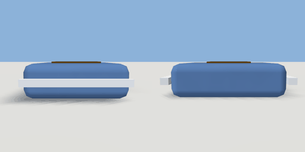

# crisps_bag

`asset: crisps_bag.yaml` · [source](../../../assets/crisps_bag.yaml) · `prop.snack`

 

A bag of crisps. Lying face up, a rounded tinted pouch with crimped silver seams at
both ends and a label; a carryable physics prop; vending_machine.yaml hands
them out (items/crisps.yaml). Origin: bottom centre; the seams are at -Z and +Z.

```yaml
place:
  crisps_bag: {asset: crisps_bag.yaml, params: {colour: car_blue}}
```

## Params

| Param | Default | Choices | Notes |
| --- | --- | --- | --- |
| `colour` | `car_blue` | text |  |

## Size

0.15 x 0.053 x 0.194 m (x, y, z); geometry (-0.075, 0, -0.097) to (0.075, 0.053, 0.097) from the origin; 144 triangles

## Parts

`pouch` (cube), `seam_back` (cube), `seam_front` (cube), `label` (cube)
