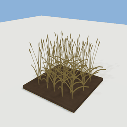
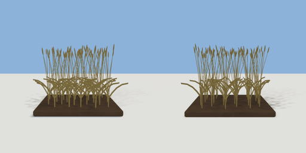

# crop_patch

`asset: crop_patch.yaml` · [source](../../../assets/crop_patch.yaml) · `vegetation.crop`

 

A bed of tilled soil with a crop growing in it: the crop generator's review piece, and
the look of a farm plot (crop `kind` at `growth` 0-1). Origin: on the ground at the
bed's middle.

```yaml
place:
  crop_patch: {asset: crop_patch.yaml, params: {kind: pumpkin, growth: 1}}
```

## Params

| Param | Default | Choices | Notes |
| --- | --- | --- | --- |
| `kind` | `wheat` | wheat, carrot, pumpkin |  |
| `growth` | `1` |  |  |
| `seed` | `0` |  |  |
| `height` | `0.9` |  |  |

## Size

1.478 x 0.969 x 1.385 m (x, y, z); geometry (-0.761, 0, -0.685) to (0.716, 0.969, 0.7) from the origin; 6588 triangles

## Parts

`soil` (cube), `crop` (crop)
