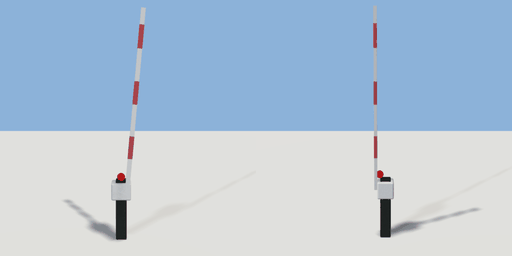

# crossing_barrier

`asset: crossing_barrier.yaml` · [source](../../../assets/crossing_barrier.yaml) · `street.barrier`

 

Level crossing barrier: a post with a red-and-white arm that lowers across a
road lane. Origin at the foot of the post; the arm reaches along +X (over the
lane). Its `barrier` interaction (up | down) is driven by trains (train.gd);
road traffic stops for a lowered barrier.

```yaml
place:
  crossing_barrier: {asset: crossing_barrier.yaml, params: {reach: 3.6}, state: down}
```

## Params

| Param | Default | Choices | Notes |
| --- | --- | --- | --- |
| `reach` | `3.6` |  | arm length over the road |

## Size

0.679 x 4.635 x 0.403 m (x, y, z); geometry (-0.2, 0, -0.17) to (0.479, 4.635, 0.233) from the origin; 1026 triangles

## Parts

`post` (cube), `housing` (cube), `warning_lamp` (sphere), `arm` (cube), `arm_band_1` (cube), `arm_band_2` (cube), `arm_band_3` (cube)

## Interactions

barrier: up*, down (* initial; rotates arm, arm_band_1, arm_band_2, arm_band_3)
