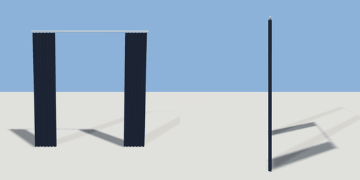

# curtains

`asset: curtains.yaml` · [source](../../../assets/curtains.yaml) · `furniture.curtains`

 

Pair of pleated curtains on a chrome rod, drawn open to the sides.
Origin: bottom-centre on the wall (floor level), fabric hangs in front (+Z).

```yaml
place:
  curtains: {asset: curtains.yaml, params: {width: 2.4, height: 2.45}}
```

## Params

| Param | Default | Choices | Notes |
| --- | --- | --- | --- |
| `width` | `2.4` |  | rod length |
| `height` | `2.45` |  | rod height above the floor |
| `panel` | `0.45` |  | width of each gathered panel |

## Size

2.4 x 2.45 x 0.16 m (x, y, z); geometry (-1.2, 0.01, 0.032) to (1.2, 2.443, 0.088) from the origin; 264 triangles

## Parts

`rod` (cylinder), `panel_left` (extrude), `panel_right` (extrude)
