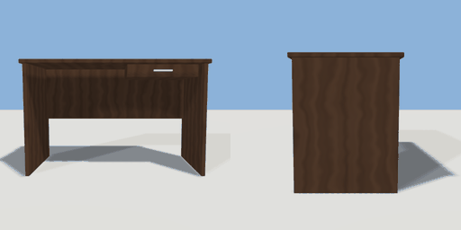

# desk

`asset: desk.yaml` · [source](../../../assets/desk.yaml) · `furniture.desk`

 

Writing desk: top on two panel ends with a modesty panel and a shallow
drawer. Origin bottom_center, the user sits on the front (+Z) side.

```yaml
place:
  desk: {asset: desk.yaml, params: {width: 1.2, height: 0.75}}
```

## Params

| Param | Default | Choices | Notes |
| --- | --- | --- | --- |
| `width` | `1.2` |  |  |
| `height` | `0.75` |  |  |
| `depth` | `0.6` |  |  |
| `board` | `0.025` |  |  |

## Size

1.2 x 0.75 x 0.6 m (x, y, z); geometry (-0.6, 0, -0.3) to (0.6, 0.75, 0.3) from the origin; 1220 triangles

## Parts

`top` (extrude), `end_left` (cube), `end_right` (cube), `modesty` (cube), `drawer_front` (cube), `drawer_body` (cube), `drawer_handle` (cube)

## Attachments

| Attachment | Position | Facing |
| --- | --- | --- |
| `seat` | (0, 0, 0.4) | south |

## Surfaces

| Surface | Size (u x v, m) | Facing |
| --- | --- | --- |
| `top` | 1.2 x 0.6 | +Y |

## Clearance

front 0.9
