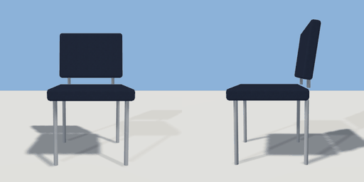

# desk_chair

`asset: desk_chair.yaml` · [source](../../../assets/desk_chair.yaml) · `furniture.chair`

 

Upholstered desk chair on four slim metal legs. Origin bottom_center,
the seat faces +Z.

```yaml
place:
  desk_chair: {asset: desk_chair.yaml, params: {width: 0.5, depth: 0.52}}
```

## Params

| Param | Default | Choices | Notes |
| --- | --- | --- | --- |
| `width` | `0.5` |  |  |
| `depth` | `0.52` |  |  |
| `height` | `0.85` |  |  |
| `seat` | `0.46` |  | seat height |

## Size

0.5 x 0.85 x 0.52 m (x, y, z); geometry (-0.25, 0, -0.281) to (0.25, 0.85, 0.26) from the origin; 504 triangles

## Parts

`seat` (cube), `back` (cube), `leg_fl` (cylinder), `leg_fr` (cylinder), `leg_bl` (cylinder), `leg_br` (cylinder), `back_post_left` (cylinder), `back_post_right` (cylinder)

## Attachments

| Attachment | Position | Facing |
| --- | --- | --- |
| `sit` | (0, 0, 0.56) | outward |

## Affordances

sit at (0, 0.46, 0.03) height 0.46 [seat, desk]

## Clearance

front 0.5
