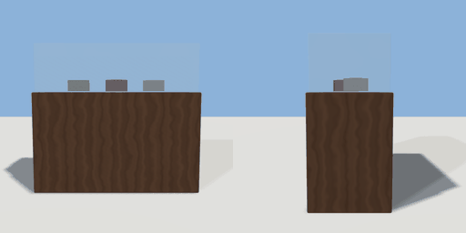

# display_case

`asset: display_case.yaml` · [source](../../../assets/display_case.yaml) · `shop.display_case` `furniture.counter`

 

A glass-topped display case (cakes in a cafe, books or jewellery in a
shop): a cabinet with a glass box on top holding a few items.

```yaml
place:
  display_case: {asset: display_case.yaml, params: {width: 1.4}}
```

## Params

| Param | Default | Choices | Notes |
| --- | --- | --- | --- |
| `width` | `1.4` |  |  |

## Size

1.4 x 1.25 x 0.6 m (x, y, z); geometry (-0.7, 0, -0.3) to (0.7, 1.25, 0.3) from the origin; 912 triangles

## Parts

`cabinet` (cube), `glass` (cube), `item_1` (cylinder), `item_2` (cylinder), `item_3` (cylinder)

## Clearance

front 0.9
