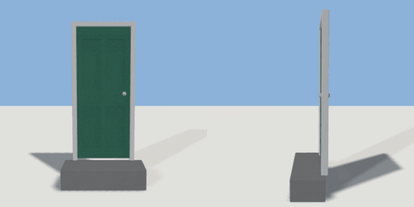

# door

`asset: door.yaml` · [source](../../../assets/door.yaml) · `door.exterior`

 

Four-panel front door with frame, knob and step.

Place it on a wall surface; it cuts its own opening into the wall:

```yaml
door: { asset: door.yaml, on: house.front_wall, at: {u: 0.5, v: {abs: 0}} }
```

Origin is the bottom-centre of the opening on the wall face; +Z points out.

```yaml
place:
  door: {asset: door.yaml, on: <object>.<wall surface>, at: {u: 0.5, v: {abs: 0}}, params: {width: 0.95, height: 2.1}, state: open}
```

## Params

| Param | Default | Choices | Notes |
| --- | --- | --- | --- |
| `width` | `0.95` |  |  |
| `height` | `2.1` |  |  |
| `frame` | `0.07` |  |  |
| `recess` | `0.1` |  |  |
| `step_height` | `0.3` |  | match the host's foundation so the step meets the ground |
| `leaf_gap` | `0.03` |  | gap under the leaf |
| `open_angle` | `100` |  | how far the leaf swings in (degrees) |

## Size

0.95 x 2.1 x 1 m (x, y, z); geometry (-0.6, -0.303, -0.178) to (0.6, 2.1, 0.345) from the origin; 1044 triangles

## Opening

cuts its own hole in the surface it is placed `on` (origin: bottom centre of the opening on the wall face, +Z out of the wall)

## Parts

`opening` (cube), `reveal` (cube), `frame` (extrude), `leaf` (extrude), `panel_top_left` (cube), `panel_top_right` (cube), `panel_bottom_left` (cube), `panel_bottom_right` (cube), `knob` (sphere), `knob_inside` (sphere), `step` (cube)

## Interactions

swing: closed* -> open, open -> closed (* initial; rotates leaf, knob, knob_inside)

## Affordances

stand at (0, 0, 1.4) [outside]

## Portal

interaction swing, open open, closed closed, center [0,1.05,-0.15], normal [0,0,1], width 0.81, height 2.1, depth 0.4, clearance 0.95
