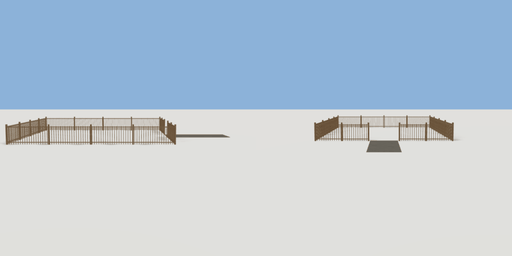

# farm_field

`asset: farm_field.yaml` · [source](../../../assets/farm_field.yaml) · `farm.field`

 

A farm's field: a fenced rectangle of grass for plots, with a gate gap in the east
side and a gravel track from it. Origin: on the ground at the field's middle.

```yaml
place:
  farm_field: {asset: farm_field.yaml, params: {width: 9, depth: 8}}
```

## Params

| Param | Default | Choices | Notes |
| --- | --- | --- | --- |
| `width` | `9` |  |  |
| `depth` | `8` |  |  |

## Size

13.04 x 1.08 x 8.08 m (x, y, z); geometry (-4.54, 0.05, -4.04) to (8.5, 1.13, 4.04) from the origin; 3516 triangles

## Parts

`fence` (fence), `track` (cube)
