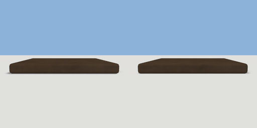

# farm_plot

`asset: farm_plot.yaml` · [source](../../../assets/farm_plot.yaml) · `farm.plot`

 

A tilled plot to grow a crop in: a raised bed of soil. Drop a packet of seeds on it
(wheat_seeds, carrot_seeds, pumpkin_seeds: the soil is a sink that takes them in) and it
is planted; the crop comes up and grows on the game clock, `stage_hours` a stage
(planted, sprouting, grown), and keeps growing while nobody is there. Use a grown plot to
harvest it: the crop goes in the user's inventory (items/wheat.yaml, carrot.yaml,
pumpkin.yaml) and the plot is empty again. A packet dropped on a plot that is already
growing something is lost. Origin: on the ground at the bed's middle.

```yaml
place:
  farm_plot: {asset: farm_plot.yaml, params: {stage_hours: 6, seed: 0}, state: wheat_planted}
```

## Params

| Param | Default | Choices | Notes |
| --- | --- | --- | --- |
| `stage_hours` | `6` |  |  |
| `seed` | `0` |  |  |

## Size

1.59 x 0.964 x 1.456 m (x, y, z); geometry (-0.65, 0, -0.65) to (0.65, 0.12, 0.65) from the origin; 108 triangles

## Parts

`soil` (cube), `seedlings` (crop), `wheat_young` (crop), `wheat_ripe` (crop), `carrot_young` (crop), `carrot_ripe` (crop), `pumpkin_young` (crop), `pumpkin_ripe` (crop)

## Interactions

crop: empty*, wheat_planted (then wheat_sprouting after {minutes:360.0} s), wheat_sprouting (then wheat_grown after {minutes:360.0} s), wheat_grown -> wheat_harvested, wheat_harvested (then empty), carrot_planted (then carrot_sprouting after {minutes:360.0} s), carrot_sprouting (then carrot_grown after {minutes:360.0} s), carrot_grown -> carrot_harvested, carrot_harvested (then empty), pumpkin_planted (then pumpkin_sprouting after {minutes:360.0} s), pumpkin_sprouting (then pumpkin_grown after {minutes:360.0} s), pumpkin_grown -> pumpkin_harvested, pumpkin_harvested (then empty) (* initial; shows/hides seedlings; shows/hides wheat_young; shows/hides wheat_ripe; shows/hides carrot_young; shows/hides carrot_ripe; shows/hides pumpkin_young; shows/hides pumpkin_ripe)

## Named places

bed: box 1.2 x 0.1 x 1.2 m at (0, 0.17, 0)
