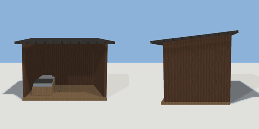

# farm_shed

`asset: farm_shed.yaml` · [source](../../../assets/farm_shed.yaml) · `farm.shed`

 

A farm's lean-to shed to sleep in: a plank floor, three board walls and a sloping roof,
open at the front, with a cot inside. Use the cot to sleep until 06:00 (a skip effect:
the clock jumps on and whatever is growing catches up). Origin: on the ground at the
floor's middle; the open side faces +Z.

```yaml
place:
  farm_shed: {asset: farm_shed.yaml, state: asleep}
```

## Size

3.5 x 2.556 x 2.888 m (x, y, z); geometry (-1.75, 0, -1.394) to (1.75, 2.556, 1.494) from the origin; 892 triangles

## Parts

`floor` (cube), `back` (cube), `side_l` (cube), `side_r` (cube), `gable_l` (prism), `gable_r` (prism), `roof` (cube), `cot_frame` (cube), `mattress` (cube), `pillow` (cube), `blanket` (cube)

## Interactions

sleep: awake* -> asleep, asleep (then awake after 0.5 s) (* initial)
