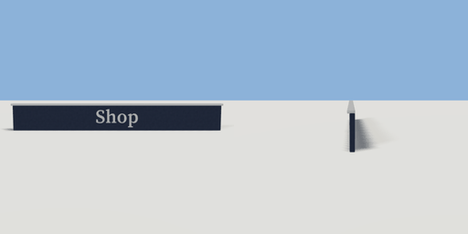

# fascia_sign

`asset: fascia_sign.yaml` · [source](../../../assets/fascia_sign.yaml) · `decor.sign` `decor.wall`

 

A shop or restaurant fascia: a painted board with raised lettering and a
slim cap, for fixing across a front wall above the door and windows.
Wall-mounted: origin on the wall plane at the board's bottom centre, the
lettering faces +Z (out of the wall).

```yaml
place:
  fascia_sign: {asset: fascia_sign.yaml, params: {font: sans, label: Shop}}
```

## Params

| Param | Default | Choices | Notes |
| --- | --- | --- | --- |
| `label` | `Shop` | text |  |
| `width` | `5` |  |  |
| `height` | `0.6` |  |  |
| `letter` | `0.3` |  |  |
| `font` | `serif` | serif, sans |  |

## Size

5.06 x 0.65 x 0.12 m (x, y, z); geometry (-2.53, 0, 0) to (2.53, 0.65, 0.12) from the origin; 1408 triangles

## Parts

`board` (cube), `cap` (cube), `lettering` (text)
