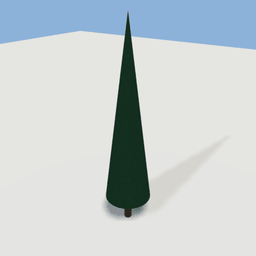
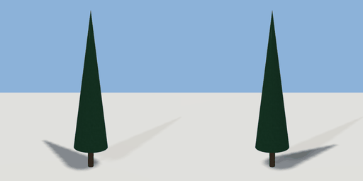

# fir_bundle

`asset: fir_bundle.yaml` · [source](../../../assets/fir_bundle.yaml) · `decor.christmas`

 

A fir tree wrapped in netting for the journey home: what is carried in (items/fir_tree.yaml).
Origin at the cut end of the trunk, the tip up.

```yaml
place:
  fir_bundle: {asset: fir_bundle.yaml}
```

## Size

0.42 x 1.9 x 0.42 m (x, y, z); geometry (-0.21, 0, -0.21) to (0.21, 1.9, 0.21) from the origin; 112 triangles

## Parts

`trunk` (cylinder), `boughs` (cone)
