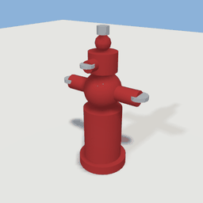
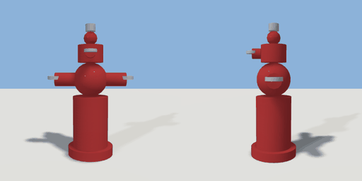

# fire_hydrant

`asset: fire_hydrant.yaml` · [source](../../../assets/fire_hydrant.yaml) · `street.fire_hydrant`

 

Fire hydrant - classic American style
Uses hierarchical attachment: barrel -> sphere -> outlets
Origin is at bottom_center
Size fractions are [x, y, z] relative to container [width, height, width]

```yaml
place:
  fire_hydrant: {asset: fire_hydrant.yaml, params: {width: 0.3, height: 0.8}}
```

## Params

| Param | Default | Choices | Notes |
| --- | --- | --- | --- |
| `width` | `0.3` |  |  |
| `height` | `0.8` |  |  |

## Size

0.51 x 0.77 x 0.295 m (x, y, z); geometry (-0.255, 0, -0.135) to (0.255, 0.77, 0.16) from the origin; 1392 triangles

## Parts

`base` (cylinder), `barrel` (cylinder), `bulge` (sphere), `neck` (cylinder), `bonnet` (sphere), `top_nut` (cylinder), `left_outlet` (cylinder), `left_cap` (cylinder), `right_outlet` (cylinder), `right_cap` (cylinder), `front_outlet` (cylinder), `front_cap` (cylinder)
