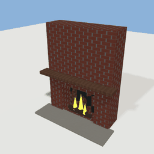
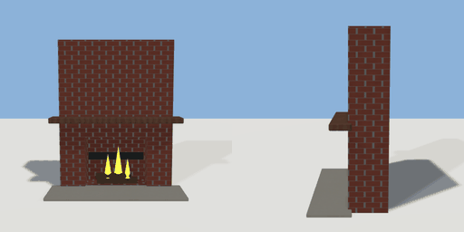

# fireplace

`asset: fireplace.yaml` · [source](../../../assets/fireplace.yaml) · `furniture.fireplace` `quality.warm`

 

A brick fireplace with a chimney breast up to the ceiling, a wooden mantel and a low fire of logs
that gives the room its warm light. Stands against a wall. Origin: on the floor at the middle
of its back; it faces +Z.

```yaml
place:
  fireplace: {asset: fireplace.yaml, params: {height: 2.5}}
```

## Params

| Param | Default | Choices | Notes |
| --- | --- | --- | --- |
| `height` | `2.5` |  |  |

## Size

2.2 x 2.5 x 1.1 m (x, y, z); geometry (-1.1, 0, 0) to (1.1, 2.5, 1.1) from the origin; 706 triangles

## Parts

`breast` (cube), `opening` (cube), `firebox` (cube), `hearth` (cube), `mantel` (cube), `log_0` (cylinder), `log_1` (cylinder), `flame_0` (cone), `flame_1` (cone), `flame_2` (cone)

## Light

type omni, color [1,0.62,0.3], energy 2.2, range 6.5, offset [0,0.45,0.62]
