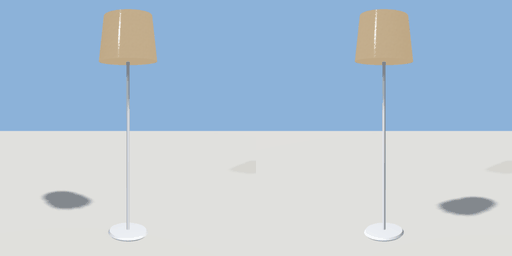

# floor_lamp

`asset: floor_lamp.yaml` · [source](../../../assets/floor_lamp.yaml) · `furniture.lamp` `light.floor_lamp`

 

Floor lamp: weighted round base, slim pole, drum shade. Origin bottom_center.

```yaml
place:
  floor_lamp: {asset: floor_lamp.yaml, params: {height: 1.6, shade: 0.42}}
```

## Params

| Param | Default | Choices | Notes |
| --- | --- | --- | --- |
| `height` | `1.6` |  |  |
| `shade` | `0.42` |  | shade diameter |

## Size

0.42 x 1.6 x 0.42 m (x, y, z); geometry (-0.21, 0, -0.21) to (0.21, 1.6, 0.21) from the origin; 660 triangles

## Parts

`base` (lathe), `pole` (cylinder), `shade` (lathe)

## Light

type omni, color [1,0.93,0.82], energy 0.9, range 4, offset [0,1.42,0]

## Clearance

front 0.3
